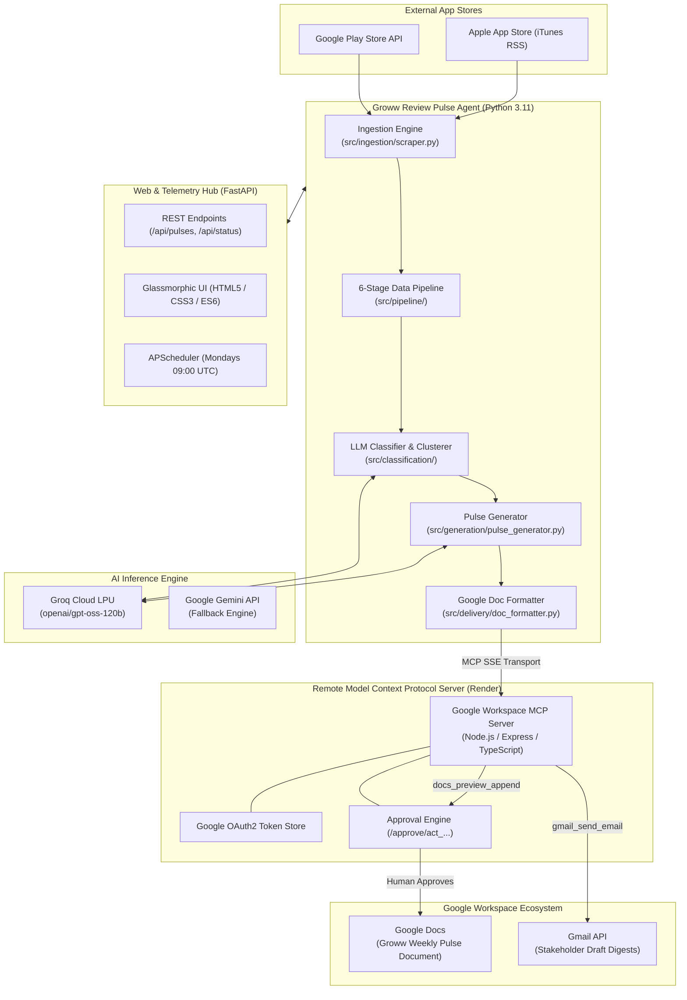

# 📈 Groww App Review Pulse Agent & Telemetry Dashboard

[](https://python.org)
[](https://fastapi.tiangolo.com)
[](https://groq.com)
[](https://modelcontextprotocol.io)
[](https://docker.com)
[](https://railway.app)
[](https://docs.pytest.org)

An autonomous AI review intelligence agent and telemetry dashboard designed for fintech product, growth, and engineering teams. The agent continuously ingests customer reviews from both the **Google Play Store** and **Apple App Store** for **Groww**, performs multi-stage NLP cleaning, spam filtering, language detection, and LLM theme clustering, synthesizes executive weekly pulse notes, and publishes them across familiar enterprise surfaces—**Google Docs** and **Gmail**—via an isolated **Model Context Protocol (MCP)** server with Human-in-the-Loop (HITL) safety approvals.

---

## 📑 Table of Contents

- [Overview & What It Solves](#-overview--what-it-solves)
- [Key Features](#-key-features)
- [System Architecture](#-system-architecture)
- [Tech Stack](#-tech-stack)
- [How MCP (Model Context Protocol) Works](#-how-mcp-model-context-protocol-works)
  - [MCP Server Architecture & Repository](#mcp-server-architecture--repository)
  - [Human-in-the-Loop (HITL) Approval Flow](#human-in-the-loop-hitl-approval-flow)
  - [Google Doc Executive Formatter](#google-doc-executive-formatter)
- [Directory Structure](#-directory-structure)
- [Quickstart Guide](#-quickstart-guide)
  - [1. Prerequisites](#1-prerequisites)
  - [2. Installation](#2-installation)
  - [3. Environment Configuration](#3-environment-configuration)
  - [4. Running the Web Dashboard](#4-running-the-web-dashboard)
  - [5. Running the Pipeline via CLI](#5-running-the-pipeline-via-cli)
- [Automated Testing](#-automated-testing)
- [Production Deployment (Railway / Docker)](#-production-deployment-railway--docker)
- [Documentation Index](#-documentation-index)

---

## 🎯 Overview & What It Solves

Mobile app reviews contain the most direct, unfiltered voice of the customer: critical transaction bugs, order execution slippages, KYC bottlenecks, and usability praises. However, reading through hundreds or thousands of weekly reviews manually is inefficient and noisy.

This agent automates the end-to-end lifecycle:
1. **Multi-Source Ingestion**: Ingests fresh reviews across Google Play Store and Apple App Store (iTunes RSS).
2. **Deterministic Pre-Processing**: Cleans boilerplate, filters noise (< 10 words, 1-word rants), eliminates duplicates and spam (TF-IDF cosine similarity), and verifies language confidence.
3. **Hybrid AI Classification**: Uses high-speed Groq LPU inference (`openai/gpt-oss-120b` or `llama-3.3-70b-versatile`) coupled with VADER sentiment scoring to categorize reviews into a 9-theme fintech taxonomy.
4. **Verbatim Quote Curation**: Automatically ranks and isolates real, high-signal verbatim customer feedback without inventing wording.
5. **Weekly Pulse Synthesis**: Produces structured weekly executive notes complete with Top Emerging Themes, Longitudinal Sentiment Shifts, Customer Quotes, and 3 Grounded Action Ideas.
6. **Workspace Delivery via MCP**: Safely appends the formatted digest into a designated Google Doc and drafts a Gmail email for stakeholders.

---

## ✨ Key Features

- **Cross-Platform Ingestion**: Dual-store scraping (Google Play via `google-play-scraper`, Apple App Store via iTunes JSON RSS) with incremental watermark tracking.
- **6-Stage Data Pipeline**:
  - `Cleaner`: Strips emojis/abbreviations while preserving sentiment signals.
  - `Language Filter`: Enforces language confidence thresholds (filtering non-English or corrupted text).
  - `Spam & Noise Filter`: Uses TF-IDF vectorization and cosine similarity deduplication (> 0.95 threshold).
  - `Sentiment Scorer`: Blends star ratings, VADER compound score, and text length heuristics into a balanced (-1.0 to +1.0) score.
  - `Clusterer & Classifier`: Taxonomy-guided LLM zero-shot categorization across 9 critical fintech domains.
  - `Quote Scorer`: Algorithmic selection of high-conviction verbatim customer quotes.
- **Executive Google Doc Publishing**: Transforms raw markdown into formatted document layouts with Unicode dividers, metric callout boxes, and clean typography.
- **Glassmorphic Telemetry Dashboard**:
  - Real-time KPI summaries: Total reviews, average rating, sentiment distribution.
  - Longitudinal trend analytics across historical weeks (`2026-W20` through `2026-W40`).
  - Searchable review explorer with filters for rating, theme, sentiment, and store source.
  - On-demand pipeline triggers with live streaming execution logs and progress badges.
- **Isolated MCP Google Workspace Integration**: Connects via Server-Sent Events (SSE) to a remote Node.js MCP server on Render, requiring cryptographic approval before modifying Google Docs or sending emails.

---

## 🏗️ System Architecture



---

## 💻 Tech Stack

### Backend & Pipeline
- **Language**: Python 3.11+
- **Framework**: [FastAPI](https://fastapi.tiangolo.com/) + [Uvicorn](https://www.uvicorn.org/) ASGI server
- **Scheduling**: [APScheduler](https://apscheduler.readthedocs.io/) for weekly recurring cron executions
- **Data Validation & Config**: [Pydantic v2](https://docs.pydantic.dev/) + `python-dotenv`
- **Data Stores**: Local JSON persistence + Persistent Railway Volume (`/app/data`)

### Machine Learning & NLP
- **LLM Engine**: [Groq Cloud](https://groq.com/) (`openai/gpt-oss-120b`, `llama-3.3-70b-versatile`) for sub-second classification & generation
- **Sentiment Analysis**: [vaderSentiment](https://github.com/cjhutto/vaderSentiment) with custom financial/app domain tuning
- **Language Detection**: [langdetect](https://pypi.org/project/langdetect/)
- **Text Vectorization & Deduplication**: [scikit-learn](https://scikit-learn.org/) (TF-IDF vectorizer + Cosine Similarity)

### Protocol & Integrations
- **Model Context Protocol (MCP)**: Custom HTTP SSE client (`RemoteSSEMCPClient`) supporting JSON-RPC 2.0 tool invocation, session management, and Bearer authentication
- **External MCP Server**: [aiagentserver](https://github.com/Shashikiran-R/aiagentserver) (Node.js/TypeScript MCP Server hosted on Render)

### Frontend Dashboard
- **Design System**: Vanilla CSS3 Glassmorphism (dark mode, backdrop blur, custom CSS variables)
- **Logic**: Vanilla ES6 JavaScript (Zero external heavy JS frameworks)
- **Features**: Real-time server-sent log streaming, SVG analytics charts, dynamic sentiment pills, and week-over-week report selector

### DevOps & Containerization
- **Container**: Docker multi-stage build (`python:3.11-slim`)
- **Hosting**: [Railway](https://railway.app/) (Unified Full-Stack Container with 5GB Persistent Disk Volume)
- **Test Framework**: [Pytest](https://docs.pytest.org/) + `anyio` (101 unit and integration tests)

---

## 🔌 How MCP (Model Context Protocol) Works

### MCP Server Architecture & Repository

The agent does **not** make direct, unauthenticated REST calls to Google Workspace APIs using client secrets embedded in the application. Instead, all sensitive actions are delegated to a dedicated, security-isolated **Model Context Protocol (MCP) server**:

🔗 **MCP Server Repository**: **[https://github.com/Shashikiran-R/aiagentserver](https://github.com/Shashikiran-R/aiagentserver)**  
🌐 **Live MCP Server**: `https://aiagentserver.onrender.com`

The MCP server exposes standard tools according to the open Model Context Protocol specification:
- `google_connection_status`: Verifies OAuth authorization state and active Google scopes.
- `docs_get_document_info`: Inspects target Google Doc tabs, metadata, and latest revision ID.
- `docs_preview_append`: Pre-validates text payload and creates a pending approval token.
- `docs_append_text`: Appends the verified text once human approval is validated.
- `gmail_preview_email`: Validates email recipients, subject, and body, creating an approval request.
- `gmail_send_email`: Dispatches the approved email via Gmail API.

### Human-in-the-Loop (HITL) Approval Flow

To prevent accidental data corruption or unauthorized emails, all mutating actions enforce a **Human-in-the-Loop (HITL)** approval flow:

```
[Agent Controller] 
       │
       ▼
1. Calls MCP Tool: docs_preview_append(document_url_or_id, text)
       │
       ▼
2. MCP Server records action in SQLite (status: "pending_approval")
   and mints a unique cryptographic action ID: act_357363f0...
       │
       ▼
3. MCP Server returns:
   - action_id: "act_357363f0..."
   - approval_url: "https://aiagentserver.onrender.com/approve/act_357363f0..."
       │
       ▼
4. Approval URL is surfaced in the Web Dashboard and Agent Logs.
       │
       ▼
5. Stakeholder opens link, reviews payload diff, and clicks [Approve].
       │
       ▼
6. MCP Server sets status to "approved" and executes docs_append_text,
   updating the live Google Doc instantly.
```

### Google Doc Executive Formatter

Google Docs does not natively render raw Markdown symbols. If raw markdown (`#`, `**`, `>`) is appended via `insertText`, it renders as literal developer notation.

The agent includes a dedicated formatter ([`src/delivery/doc_formatter.py`](src/delivery/doc_formatter.py)) that translates markdown reports into an executive document layout:
- Converts markdown headings into Unicode double-line banners (`══════════════════`).
- Transforms raw quotes (`>`) into indented verbatim voice cards.
- Restructures top themes into structured metric badges with trend indicators (`[Trend: ↑]`).
- Appends clean action recommendation blocks.

---

## 📁 Directory Structure

```text
aiagent/
├── docs/                             # Comprehensive project documentation
│   ├── README.md                     # Documentation table of contents
│   ├── architecture.md               # Detailed technical architecture
│   ├── deployment-plan.md            # Railway & Docker deployment specs
│   ├── design.md                     # UI/UX design tokens & glassmorphic system
│   ├── implementation.md             # Multi-phase engineering roadmap
│   └── problemstatement.md           # Product requirements & problem statement
├── data/                             # Telemetry datasets & pulse archives
│   ├── raw/                          # Scraped raw reviews (Play Store & App Store)
│   ├── cleaned/                      # Cleaned & normalized review JSONs
│   ├── classified/                   # L1/L2 classified & sentiment-scored data
│   ├── enriched/                     # Enriched weekly data batches
│   ├── pulses/                       # Generated weekly pulse reports (.md and .html)
│   └── run_log.json                  # Complete audit trail of pipeline runs
├── src/
│   ├── agent/
│   │   └── controller.py             # Master Agent Controller orchestrating stages 1-8
│   ├── classification/
│   │   ├── clusterer.py              # Zero-shot LLM & KMeans theme clustering
│   │   ├── quote_scorer.py           # Algorithmic high-signal quote selection
│   │   └── taxonomy.py               # 9-domain fintech classification taxonomy
│   ├── delivery/
│   │   ├── doc_formatter.py          # Formats markdown into Google Doc layouts
│   │   ├── mcp_client.py             # Custom MCP Client supporting SSE transport
│   │   ├── mcp_docs.py               # Google Docs publisher via MCP tools
│   │   └── mcp_gmail.py              # Gmail drafter & dispatcher via MCP tools
│   ├── generation/
│   │   ├── pulse_generator.py        # LLM weekly pulse note generation engine
│   │   └── templates.py              # Prompts and markdown templates
│   ├── ingestion/
│   │   └── scraper.py                # Google Play Store & Apple App Store scrapers
│   ├── pipeline/
│   │   ├── cleaner.py                # Text normalization & character stripping
│   │   ├── enrichment.py             # Metadata and timestamp enrichment
│   │   ├── language_filter.py        # Language confidence validation
│   │   ├── normaliser.py             # Cross-platform schema mapping
│   │   ├── sentiment.py              # Hybrid sentiment scoring (VADER + Ratings)
│   │   └── spam_filter.py            # TF-IDF cosine similarity deduplication
│   ├── web/
│   │   ├── app.py                    # FastAPI backend endpoints & static mount
│   │   └── static/                   # Glassmorphic frontend (index.html, styles.css, app.js)
│   └── config.py                     # Central configuration & environment loader
├── scripts/
│   ├── uvicorn_wrapper.py            # Dynamic port sanitizer for container environments
│   ├── generate_all_pulses.py        # Batch generation script
│   └── process_all_weeks.py          # Batch historical processor
├── tests/                            # 101 unit and integration tests
├── Dockerfile                        # Multi-stage production container definition
├── railway.toml                      # Declarative Railway deployment config
├── Procfile                          # Process execution definition
├── pytest.ini                        # Pytest configuration
├── requirements.txt                  # Pinned dependencies
├── run_web.py                        # Web dashboard launcher script
├── main.py                           # CLI entrypoint for pipeline actions
└── README.md                         # Project overview (this file)
```

---

## 🛠️ Quickstart Guide

### 1. Prerequisites
- **Python**: Version `3.11` or higher
- **Groq API Key**: Obtain a free API key at [console.groq.com](https://console.groq.com)
- **MCP Server Access**: Access to [aiagentserver.onrender.com](https://aiagentserver.onrender.com) (or a local instance)

### 2. Installation
```bash
# Clone the repository
git clone https://github.com/Shashikiran-R/groww-pulse-mail-agent.git
cd groww-pulse-mail-agent

# Create and activate a virtual environment
python3 -m venv .venv
source .venv/bin/activate

# Install dependencies
pip install -r requirements.txt
```

### 3. Environment Configuration
Create a `.env` file in the root directory:
```env
# --- LLM Engine ---
LLM_PROVIDER=groq
GROQ_API_KEY=your_groq_api_key_here
GROQ_MODEL=openai/gpt-oss-120b

# --- Target Applications ---
APP_ID=com.nextbillion.groww
APP_STORE_APP_ID=1404871703
APP_STORE_APP_NAME=groww-stocks-mutual-fund-ipo
APP_STORE_COUNTRY=in
LOOKBACK_WEEKS=12

# --- Google Workspace & Delivery ---
EMAIL_TO=your-email@example.com
PULSE_EMAIL_RECIPIENTS=your-email@example.com
GROWW_PULSE_DOC_URL=https://docs.google.com/document/d/YOUR_DOC_ID/edit
GROWW_PULSE_DOC_ID=YOUR_DOC_ID
DOC_TITLE_PREFIX=Groww Weekly Pulse

# --- Remote MCP Server (Render) ---
MCP_SERVER_URL=https://aiagentserver.onrender.com
MCP_TRANSPORT=sse
MCP_AUTH_TOKEN=mcp_secret_token_render_2026
```

### 4. Running the Web Dashboard
Launch the FastAPI server and telemetry frontend:
```bash
python run_web.py
```
Open **[http://localhost:8000](http://localhost:8000)** in your browser:
- 📊 **Dashboard UI**: `http://localhost:8000/`
- 📑 **Interactive OpenAPI Docs**: `http://localhost:8000/docs`
- ⚡ **API Status**: `http://localhost:8000/api/status`

### 5. Running the Pipeline via CLI
You can also run specific stages or the full pipeline using `main.py`:
```bash
# Run a dry-run test (generates pulse locally without modifying Google Docs)
python main.py --dry-run

# Run live execution for a specific week
python main.py --week 2026-W40

# Ingest and scrape reviews only
python main.py --scrape-only
```

---

## 🧪 Automated Testing

The project maintains a comprehensive automated test suite covering all pipeline stages, cleaner sanitization, spam similarity math, LLM clustering, MCP protocol communications, and document formatters:

```bash
# Run the complete test suite
pytest
```
```text
======================= 101 passed, 1 warning in 10.6s =======================
```

---

## 🚢 Production Deployment (Railway / Docker)

The repository is configured for zero-configuration, continuous deployment on **Railway**:

1. **Push to GitHub**:
   Ensure your latest changes are pushed to `origin/main`.
2. **Connect to Railway**:
   - In [Railway.app](https://railway.app/), create a **New Project** → **Deploy from GitHub repo**.
   - Select `groww-pulse-mail-agent`.
3. **Set Environment Variables**:
   - In Railway, navigate to **Variables** → **RAW Editor** and paste your environment variables.
4. **Attach a Persistent Volume** *(Crucial)*:
   - Navigate to **Data / Volumes** → **Add Volume**.
   - Mount Path: `/app/data`
   - Size: `5 GB`
   - *Note*: The container includes an automatic seeding mechanism ([`src/web/app.py:48-56`](src/web/app.py#L48-L56)) that automatically copies all historical datasets and pulse archives into fresh volume mounts upon startup.
5. **Start Command**:
   - Handled automatically via [`railway.toml`](railway.toml) and [`Procfile`](Procfile) using `python run_web.py`.

For exhaustive deployment options, see [docs/deployment-plan.md](docs/deployment-plan.md).

---

## 📚 Documentation Index

For deeper architectural breakdowns, design tokens, and technical documentation, visit the **[`docs/`](docs/)** directory:

- 📐 **[docs/architecture.md](docs/architecture.md)** — Architectural design, pipeline stages, and sequence flows.
- 🚀 **[docs/deployment-plan.md](docs/deployment-plan.md)** — Full production deployment plan and environment matrix.
- 🛠️ **[docs/implementation.md](docs/implementation.md)** — Step-by-step implementation specifications across all 7 project phases.
- 📋 **[docs/problemstatement.md](docs/problemstatement.md)** — Core requirements and functional goals.
- 🎨 **[docs/design.md](docs/design.md)** — Glassmorphic dashboard UI tokens, color palettes, and typography.

---

## 📄 License

This project is licensed under the MIT License.
