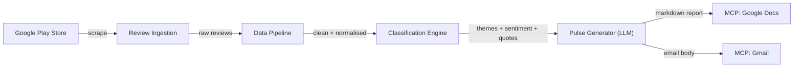
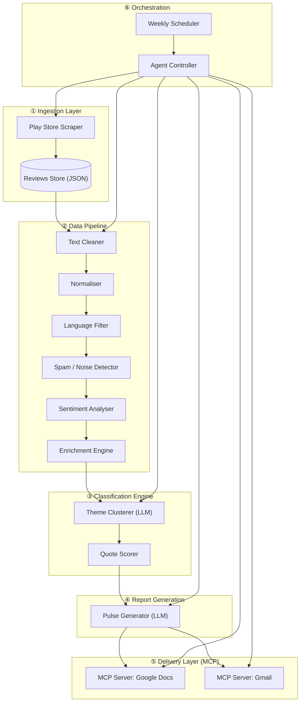
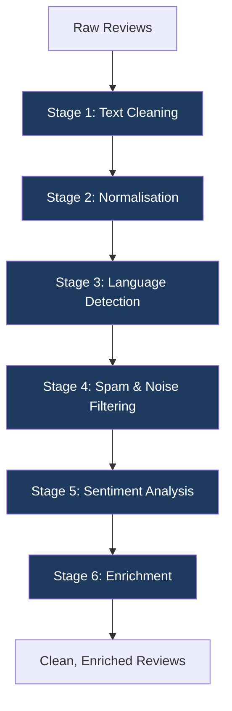
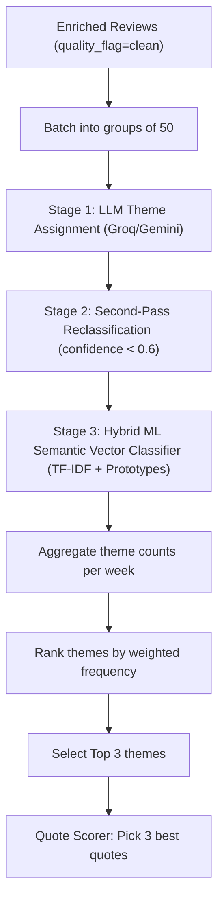
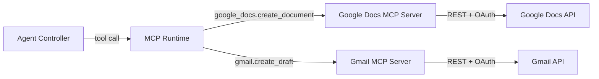
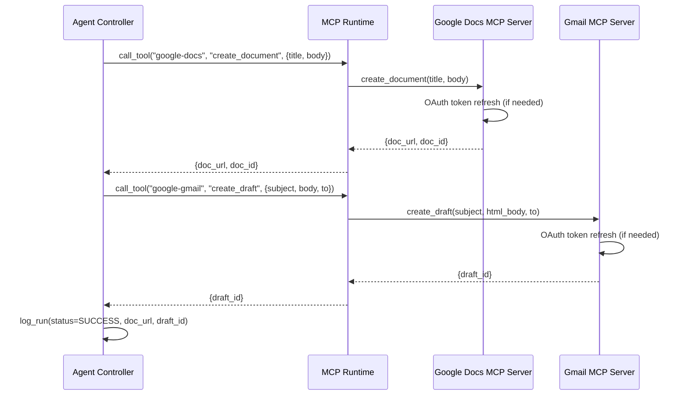
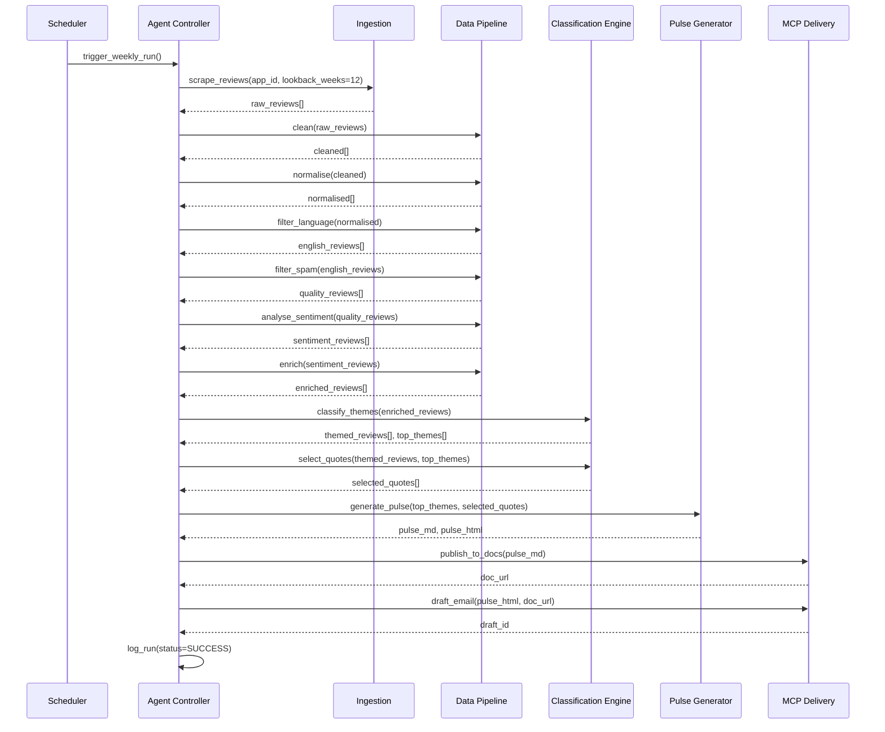
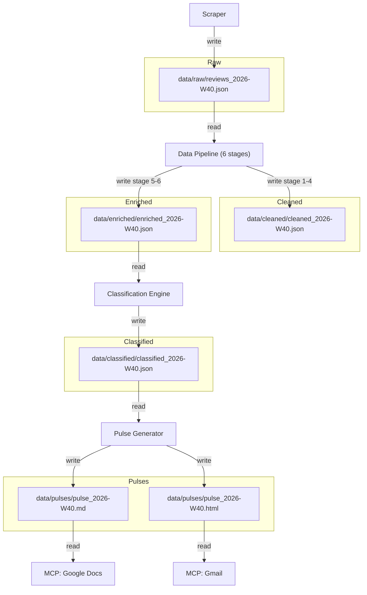
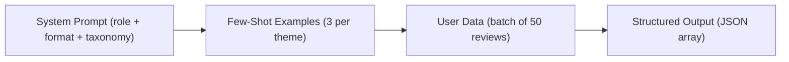

# Architecture — Groww App Review Pulse Agent

> Derived from [problemstatement.md](file:///Users/shashikiran/Desktop/aiagent/problemstatement.md)

---

## 1. System Overview

The system is an **AI-powered agent** that autonomously:

1. **Scrapes** public Google Play Store reviews for the Groww app.
2. **Cleans, normalises, and enriches** the raw review data through a multi-stage pipeline.
3. **Classifies** reviews into recurring themes and extracts sentiment signals.
4. **Generates** a concise weekly pulse report.
5. **Publishes** the report to Google Docs via **MCP tools** (no raw API wiring).
6. **Drafts** a Gmail message via **MCP tools** linking to or containing the pulse.



> [!IMPORTANT]
> **MCP-first delivery.** Google Docs and Gmail are accessed exclusively through MCP (Model Context Protocol) tool servers. The agent never handles OAuth tokens, REST endpoints, or credential files directly — the MCP servers manage authentication and API communication.

---

## 2. High-Level Architecture



---

## 3. Component Breakdown

### 3.1 Ingestion Layer

| Component              | Responsibility                                                                                      |
| ---------------------- | --------------------------------------------------------------------------------------------------- |
| **Play Store Scraper** | Fetches reviews for `com.nextbillion.groww` from the last 8–12 weeks using `google-play-scraper`.   |
| **Reviews Store**      | Persists raw reviews locally as JSON with deduplication by review ID.                               |

**Raw review schema (as received from scraper):**

```json
{
  "review_id": "gp:AOqpTOH...",
  "author": "string",
  "rating": 4,
  "title": "string | null",
  "text": "string",
  "date": "2026-09-15T00:00:00Z",
  "thumbs_up": 12,
  "app_version": "6.2.1",
  "reply_text": "string | null",
  "reply_date": "ISO-8601 | null"
}
```

> [!NOTE]
> The `google-play-scraper` Python library handles pagination and returns structured data without API keys. Reviews are fetched sorted by `newest` to capture the latest window.

---

### 3.2 Data Pipeline (Cleaning → Normalisation → Filtering → Enrichment)

This is the **heart of data quality** in the system. Raw reviews are noisy — they contain mixed languages, spam, emojis as the only content, single-word non-reviews, and inconsistent formatting. The data pipeline converts raw scraper output into **analysis-ready, normalised records** through six sequential stages.



---

#### 3.2.1 Stage 1 — Text Cleaning

Raw review text is messy. This stage applies deterministic, rule-based cleaning:

| Operation                    | Details                                                                                                   | Example                                          |
| ---------------------------- | --------------------------------------------------------------------------------------------------------- | ------------------------------------------------ |
| **HTML entity decoding**     | Convert `&amp;`, `&lt;`, `&#39;` etc. to their plain-text equivalents                                    | `can&#39;t` → `can't`                            |
| **URL removal**              | Strip embedded URLs (regex: `https?://\S+`)                                                               | `check https://groww.in for more` → `check for more` |
| **Email removal**            | Strip email addresses to avoid PII leakage into LLM prompts                                              | `mail me at user@x.com` → `mail me at`           |
| **Excessive punctuation**    | Collapse repeated punctuation (`!!!!!!` → `!`, `????` → `?`)                                             | `worst!!!!!` → `worst!`                          |
| **Whitespace normalisation** | Replace `\t`, `\n`, multiple spaces with single space; trim leading/trailing                              | `"  bad   app  "` → `"bad app"`                  |
| **Control character strip**  | Remove zero-width joiners, BOM, invisible Unicode characters                                              |                                                  |
| **Emoji classification**     | Separate emojis into a dedicated `emojis` field rather than stripping them (emojis carry sentiment signal) | `😡🤬 bad app` → text: `bad app`, emojis: `😡🤬` |

**Output fields added:** `cleaned_text`, `emojis`

---

#### 3.2.2 Stage 2 — Normalisation

Transform cleaned text into a consistent, comparable form:

| Operation                     | Details                                                                                                                                       |
| ----------------------------- | --------------------------------------------------------------------------------------------------------------------------------------------- |
| **Case normalisation**        | Convert to lowercase for downstream comparison and clustering. Original case preserved in `original_text`.                                    |
| **Unicode normalisation**     | Apply `NFKC` normalisation to fold ligatures and compatibility characters (e.g., `fi` → `fi`, `²` → `2`).                                    |
| **Transliteration handling**  | Indian users often write in Hinglish (Hindi written in Latin script). Detect and flag — do NOT translate, to preserve original voice.          |
| **Number standardisation**    | Normalise written numbers: `two days` → keep as-is, but standardise formats like `2,00,000` (Indian lakhs) into context-aware representations.|
| **Abbreviation expansion**    | Expand common fintech abbreviations: `KYC` → keep (domain term), `txn` → `transaction`, `amt` → `amount`, `govt` → `government`.            |
| **Rating normalisation**      | Ensure `rating` is integer 1–5; coerce edge cases.                                                                                           |
| **Date normalisation**        | Parse all dates into ISO-8601 UTC format. Handle timezone discrepancies from scraper.                                                         |

**Output fields added:** `normalised_text`, `original_text` (preserved), `is_hinglish`

---

#### 3.2.3 Stage 3 — Language Detection & Filtering

Not all reviews are usable for English-language analysis:

| Operation                | Details                                                                                                     |
| ------------------------ | ----------------------------------------------------------------------------------------------------------- |
| **Language detection**   | Use `langdetect` or `lingua` library to identify language per review.                                       |
| **English filter**       | Retain reviews detected as English or Hinglish. Flag others as `excluded_language`.                         |
| **Confidence threshold** | Only exclude if language confidence > 0.8 for a non-English language (avoids false positives on short text). |
| **Hinglish handling**    | Reviews detected as Hindi but written in Latin script → flag `is_hinglish=true`, keep in pipeline.          |

> [!TIP]
> Hinglish reviews are extremely common for Indian apps like Groww. Excluding them would lose a significant portion of actionable feedback. The LLM can understand Hinglish context.

**Output fields added:** `detected_language`, `language_confidence`, `excluded_language`

---

#### 3.2.4 Stage 4 — Spam & Noise Filtering

Remove reviews that add no analytical value:

| Filter                        | Rule                                                                                           | Action        |
| ----------------------------- | ---------------------------------------------------------------------------------------------- | ------------- |
| **Empty / near-empty**        | `len(normalised_text) < 10` characters after cleaning                                          | Mark as noise |
| **Emoji-only**                | Text is empty but `emojis` field is non-empty                                                  | Mark as noise |
| **Single-word reviews**       | Only one word (e.g., `"good"`, `"bad"`, `"nice"`)                                             | Mark as noise |
| **Repetitive character spam** | Same character repeated > 5 times (e.g., `aaaaaaa`, `gggggg`)                                 | Mark as noise |
| **Bot-like patterns**         | Suspiciously similar text across multiple review IDs within same time window (cosine similarity > 0.95) | Mark as spam  |
| **Incentivised reviews**      | Contains patterns like `"5 stars for reward"`, `"giving 5 star for coins"`, `"rate for cashback"` | Mark as spam  |
| **Rating-text mismatch**      | 5-star rating with strongly negative text, or 1-star with glowing text (likely accidental taps) | Flag for review |

**Filtering strategy:** Flagged reviews are **not deleted** — they're marked with `quality_flag` and excluded from downstream analysis but kept in storage for auditability.

**Output fields added:** `quality_flag` (one of: `clean`, `noise`, `spam`, `mismatch`), `quality_reason`

---

#### 3.2.5 Stage 5 — Sentiment Analysis

Attach granular sentiment signals to each review before theme classification:

| Method                       | Details                                                                                                 |
| ---------------------------- | ------------------------------------------------------------------------------------------------------- |
| **Rating-based baseline**    | `rating >= 4` → positive, `3` → neutral, `<= 2` → negative. Cheap, always available.                  |
| **Text-based sentiment**     | Use `TextBlob` or `VADER` for rule-based polarity scoring (no API cost). Returns `polarity` (-1 to +1). |
| **Emoji sentiment boost**    | Map extracted emojis to sentiment scores (😡 = -0.8, 😊 = +0.7, etc.) and combine with text polarity.  |
| **Composite score**          | Weighted average: `0.4 × rating_normalised + 0.4 × text_polarity + 0.2 × emoji_sentiment`             |
| **Sentiment label**          | Derived from composite: `strongly_negative` (< -0.5), `negative` (-0.5 to -0.1), `neutral` (-0.1 to 0.1), `positive` (0.1 to 0.5), `strongly_positive` (> 0.5) |

> [!NOTE]
> Sentiment is computed **before** LLM classification to avoid burning LLM tokens on sentiment. The LLM focuses on theme assignment; sentiment comes from deterministic scoring.

**Output fields added:** `sentiment_score`, `sentiment_label`, `text_polarity`, `emoji_sentiment`

---

#### 3.2.6 Stage 6 — Enrichment

Add derived metadata to make each review maximally useful for analysis:

| Enrichment                  | Details                                                                                               |
| --------------------------- | ----------------------------------------------------------------------------------------------------- |
| **Week assignment**         | Compute `week` field (ISO week: `2026-W38`) from normalised date.                                    |
| **Word count**              | `word_count` of normalised text — used for quote selection (prefer substantive reviews).              |
| **Has title flag**          | `has_title: bool` — titles often contain concise summaries, useful for theme hints.                   |
| **Reply flag**              | `has_developer_reply: bool` — reviews with replies may indicate known issues.                         |
| **Version bucketing**       | Group `app_version` into major.minor buckets (`6.2.x`) for version-correlated analysis.              |
| **Helpfulness score**       | `helpfulness = thumbs_up / max(thumbs_up_in_batch)` — normalised 0 to 1.                             |
| **Review age**              | `days_since_review` — newer reviews weighted higher in theme ranking.                                 |
| **Quote candidacy score**   | Pre-compute a score: `word_count ∈ [15, 80]` + `sentiment != neutral` + `helpfulness > 0.3` → higher score. Used later by Quote Scorer. |

---

#### 3.2.7 Enriched Review Schema (Final Pipeline Output)

After all six stages, each review has this structure:

```json
{
  "review_id": "gp:AOqpTOH...",
  "author": "Rahul M.",
  "rating": 2,

  "original_text": "KYC process took 5 days!!! Very frustrating 😡 txn not going through",
  "cleaned_text": "KYC process took 5 days! Very frustrating txn not going through",
  "normalised_text": "kyc process took 5 days! very frustrating transaction not going through",
  "emojis": ["😡"],

  "title": "Worst experience",
  "has_title": true,
  "date": "2026-09-15T00:00:00Z",
  "week": "2026-W38",
  "days_since_review": 19,

  "detected_language": "en",
  "language_confidence": 0.92,
  "is_hinglish": false,
  "excluded_language": false,

  "quality_flag": "clean",
  "quality_reason": null,

  "sentiment_score": -0.65,
  "sentiment_label": "strongly_negative",
  "text_polarity": -0.72,
  "emoji_sentiment": -0.8,

  "thumbs_up": 24,
  "helpfulness": 0.85,
  "app_version": "6.2.1",
  "version_bucket": "6.2.x",
  "has_developer_reply": false,
  "word_count": 12,
  "quote_candidacy_score": 0.78,

  "theme": null,
  "sub_theme": null,
  "selected_quote": false
}
```

---

### 3.3 Classification Engine

#### 3.3.1 Theme Taxonomy

A **fixed two-level taxonomy** ensures consistent classification across weeks:

| Theme (Level 1)                | Sub-themes (Level 2)                                                     |
| ------------------------------ | ------------------------------------------------------------------------ |
| **Onboarding / KYC**          | Account creation, KYC verification delays, document upload issues, eKYC  |
| **Payments / UPI**            | UPI failures, payment gateway errors, auto-pay, SIP payments, refunds   |
| **Statements / Tax Reports**  | P&L statements, tax harvesting, capital gains report, CDSL holding      |
| **Withdrawals / Redemptions** | Withdrawal delays, bank account linking, failed redemptions, settlement  |
| **App Performance / Bugs**    | Crashes, slow loading, UI glitches, login issues, OTP failures, updates  |
| **Trading & Order Execution** | F&O trading issues, Stop loss and target triggers, Order execution slippage, Charts and TradingView, Option chain data, Intraday position squaring |
| **Brokerage & Charges**       | High brokerage charges, Hidden fees and deductions, DP charges, Annual maintenance charges (AMC), GST and regulatory fees |
| **Customer Support & Service**| Helpline unresponsiveness, Chatbot automated replies, Delayed ticket resolution, Lack of human agent, Account support complaints |
| **Usability & Positive Feedback**| User friendly UI, Beginner-friendly investment, Clean design and navigation, General praise and satisfaction, Portfolio tracking simplicity |

> [!NOTE]
> Themes are defined in `src/classification/taxonomy.py` and synced with `src/config.py`. If a review cannot be mapped to any predefined theme, it falls back to `Other`.

#### 3.3.2 Multi-Stage Classification Pipeline



**Stage 1 — Primary Theme Assignment (LLM):**

- Model: **Groq (`openai/gpt-oss-120b`)** with structured JSON output.
- Each review gets assigned a primary theme from the 9-theme taxonomy.
- Prompt includes domain few-shot examples for all themes.

**Stage 2 — Contextual Reclassification:**

- Reviews classified with `confidence < 0.6` are re-evaluated with review title and neighboring context.

**Stage 3 — Hybrid Machine Learning Classification & Fallback:**

- Uses `SemanticHybridClassifier` built on `scikit-learn`:
  - TF-IDF vectorization combining word (1-3) and character (3-5) n-grams to handle fintech jargon and typos.
  - Cosine similarity against comprehensive domain prototype documents for all 9 categories.
  - Domain regex and Hinglish phrase boosting (e.g., *"brokarage"*, *"ghatiya service"*, *"sl aur tp"*).
  - Guarantees resilient classification and prevents token quota exhaustion (TPD limits) from dropping reviews into the generic `Other` bucket.

#### 3.3.3 Theme Ranking Algorithm

Themes are ranked not just by raw count, but by a **weighted frequency** that accounts for recency and severity:

```
weighted_score(theme) =
    Σ (1.0 / days_since_review) × sentiment_weight × helpfulness
```

Where `sentiment_weight`:
- `strongly_negative` = 2.0 (amplify urgent issues)
- `negative` = 1.5
- `neutral` = 1.0
- `positive` = 0.8
- `strongly_positive` = 0.5 (positive feedback is important but less urgent)

#### 3.3.4 Quote Scorer

Selects the **3 best verbatim quotes** for the pulse:

| Criterion                          | Weight | Logic                                                     |
| ---------------------------------- | ------ | --------------------------------------------------------- |
| **Quote candidacy score**          | 0.3    | Pre-computed in enrichment stage                          |
| **Theme coverage**                 | 0.3    | Prefer quotes from different top themes (1 per theme)     |
| **Sentiment extremity**            | 0.2    | Strongly negative/positive reviews are more impactful     |
| **Helpfulness**                    | 0.1    | Other users found it useful (thumbs up)                   |
| **Word count sweet spot**          | 0.1    | 20–60 words ideal — substantive but readable              |

Selection constraint: **Exactly 1 quote per top theme** to ensure coverage diversity.

---

### 3.4 Report Generation

#### 3.4.1 Pulse Generator

| Input                            | Output                                                          |
| -------------------------------- | --------------------------------------------------------------- |
| Top 3 themes + weighted scores   | Themed summary paragraph per theme                              |
| 3 verbatim quotes + metadata     | Formatted quote blocks with ★ rating + date                     |
| Sentiment distribution per theme | 3 concrete, actionable recommendations                          |
| Week-over-week trend (if avail.) | Trend indicator (↑ ↓ → per theme vs. last week)                 |

- **Model:** Gemini 2.0 Pro — higher quality for summarisation and writing.
- **Prompt:** Structured system prompt enforcing the one-page format:

```
You are a senior product analyst at Groww, a leading Indian fintech app.
Given the following themed review data for week {week}, produce a Weekly
Pulse report with exactly:

1. **Top 3 Themes** — theme title + 2-sentence summary + review count +
   sentiment breakdown (% negative vs positive) + trend vs last week
2. **3 User Quotes** — verbatim (do NOT modify wording), with ★ rating
   and date. One quote per theme.
3. **3 Action Ideas** — specific, grounded in the data, addressable by
   the product or engineering team. Each must reference which theme it
   addresses.

Formatting rules:
- Keep the entire output under 500 words.
- Use markdown formatting.
- Never invent or paraphrase quotes — use them exactly as provided.
- Include a one-line executive summary at the top.
```

#### 3.4.2 Pulse Output Schema

```markdown
# Groww Weekly Pulse — Week 40, 2026

**Executive Summary:** KYC delays dominated negative feedback this week,
while payment reliability improved. App crashes remain a persistent concern.

## 📊 Top Themes

### 1. Onboarding / KYC (142 reviews, 78% negative) ↑
Summary...

### 2. App Performance / Bugs (89 reviews, 65% negative) →
Summary...

### 3. Payments / UPI (67 reviews, 45% negative) ↓
Summary...

## 💬 User Quotes

> ★★☆☆☆ — "KYC process took 5 days! Very frustrating, transaction not
> going through" — *Rahul M., Sep 15*

> ...

## 💡 Action Ideas

1. **[KYC]** Investigate eKYC provider SLA — 5-day turnaround is...
2. **[Bugs]** Prioritise crash on Android 14 devices reported in...
3. **[UPI]** Add retry logic with user-visible status for failed...
```

---

### 3.5 Delivery Layer — MCP Tool Integration

> [!IMPORTANT]
> The delivery layer uses **MCP (Model Context Protocol) servers** instead of direct Google API clients. This eliminates OAuth wiring, token management, and API boilerplate from the agent codebase entirely.

#### 3.5.1 What Is MCP?

MCP is a protocol that lets AI agents call external tools (APIs, services, databases) through a **standardised tool interface**. Each MCP server exposes a set of tools that the agent can invoke like function calls. The MCP server handles authentication, API formatting, and error handling internally.



#### 3.5.2 Google Docs via MCP

| Detail               | Value                                                                                            |
| --------------------- | ------------------------------------------------------------------------------------------------ |
| **MCP Server**        | `google-docs` (handles OAuth internally, token refresh, API calls)                              |
| **Tool: create_doc**  | Creates a new Google Doc with the given title and body content                                   |
| **Tool: append_doc**  | Appends content to an existing Doc (for running log mode)                                        |
| **Tool: share_doc**   | Optionally sets sharing permissions (e.g., "anyone with link can view")                          |
| **Input**             | Markdown or HTML pulse content + title                                                           |
| **Output**            | Document URL + document ID                                                                       |
| **Strategy**          | Create a new doc per week (MVP); title format: `Groww Weekly Pulse — Week {N}, {Year}`           |

#### 3.5.3 Gmail via MCP

| Detail               | Value                                                                                            |
| --------------------- | ------------------------------------------------------------------------------------------------ |
| **MCP Server**        | `google-gmail` (handles OAuth internally)                                                        |
| **Tool: create_draft**| Creates a Gmail draft with subject, body (HTML), and recipients                                  |
| **Input**             | Subject: `Groww Weekly Pulse — W{N}`, Body: HTML pulse or link to Google Doc                     |
| **To**                | Configurable in `.env` — defaults to authenticated user                                          |
| **Output**            | Draft ID + confirmation                                                                          |

#### 3.5.4 MCP Configuration

MCP servers are configured in `mcp_config.json` at the project root:

```json
{
  "servers": {
    "google-docs": {
      "command": "npx",
      "args": ["-y", "@anthropic/google-docs-mcp-server"],
      "env": {
        "GOOGLE_CLIENT_ID": "${GOOGLE_CLIENT_ID}",
        "GOOGLE_CLIENT_SECRET": "${GOOGLE_CLIENT_SECRET}"
      }
    },
    "google-gmail": {
      "command": "npx",
      "args": ["-y", "@anthropic/google-gmail-mcp-server"],
      "env": {
        "GOOGLE_CLIENT_ID": "${GOOGLE_CLIENT_ID}",
        "GOOGLE_CLIENT_SECRET": "${GOOGLE_CLIENT_SECRET}"
      }
    }
  }
}
```

> [!TIP]
> Because the MCP servers manage OAuth, the agent code has **zero Google API imports**. The agent simply calls `mcp.call_tool("google-docs", "create_document", {...})` and receives the doc URL. This drastically simplifies the codebase and testing.

#### 3.5.5 Delivery Sequence (MCP-Based)



---

### 3.6 Orchestration Layer



---

## 4. Tech Stack

| Layer                | Technology                                                             |
| -------------------- | ---------------------------------------------------------------------- |
| **Language**         | Python 3.11+                                                           |
| **Scraping**         | `google-play-scraper`                                                  |
| **LLM**             | Google Gemini API (`google-genai` SDK)                                 |
| **Storage**          | Local JSON files (MVP) → SQLite (v2)                                   |
| **Data Processing**  | `re`, `unicodedata`, `langdetect`, `textblob` / `vaderSentiment`       |
| **Delivery**         | MCP tool servers (`google-docs`, `google-gmail`)                       |
| **MCP Runtime**      | `mcp` Python SDK                                                       |
| **Scheduling**       | `APScheduler` (in-process) or system cron                              |
| **Config**           | `.env` file via `python-dotenv`                                        |
| **Logging**          | Python `logging` module → stdout + rotating file                       |

---

## 5. Directory Structure

```
aiagent/
├── problemstatement.md           # Project context
├── architecture.md               # This document
├── requirements.txt              # Python dependencies
├── mcp_config.json               # MCP server configuration
├── .env                          # API keys & config (git-ignored)
├── .gitignore
│
├── src/
│   ├── __init__.py
│   ├── config.py                 # Load .env, constants, theme taxonomy
│   │
│   ├── ingestion/
│   │   ├── __init__.py
│   │   └── scraper.py            # Play Store review scraper
│   │
│   ├── pipeline/
│   │   ├── __init__.py
│   │   ├── cleaner.py            # Stage 1: Text cleaning
│   │   ├── normaliser.py         # Stage 2: Text normalisation
│   │   ├── language_filter.py    # Stage 3: Language detection & filtering
│   │   ├── spam_filter.py        # Stage 4: Spam & noise detection
│   │   ├── sentiment.py          # Stage 5: Sentiment analysis
│   │   ├── enrichment.py         # Stage 6: Metadata enrichment
│   │   └── pipeline.py           # Orchestrates all 6 stages sequentially
│   │
│   ├── classification/
│   │   ├── __init__.py
│   │   ├── clusterer.py          # LLM-based theme assignment
│   │   ├── quote_scorer.py       # Quote selection algorithm
│   │   └── taxonomy.py           # Theme definitions & hierarchy
│   │
│   ├── generation/
│   │   ├── __init__.py
│   │   ├── pulse_generator.py    # LLM-based pulse report generation
│   │   └── templates.py          # Prompt templates
│   │
│   ├── delivery/
│   │   ├── __init__.py
│   │   ├── mcp_docs.py           # MCP tool wrapper for Google Docs
│   │   └── mcp_gmail.py          # MCP tool wrapper for Gmail
│   │
│   └── agent/
│       ├── __init__.py
│       └── controller.py         # Orchestrates the full pipeline
│
├── data/
│   ├── raw/                      # Raw scraped reviews (JSON per run)
│   ├── cleaned/                  # After pipeline stages 1-4
│   ├── enriched/                 # After pipeline stages 5-6
│   ├── classified/               # After theme classification
│   └── pulses/                   # Generated pulse reports (MD + HTML)
│
├── tests/
│   ├── test_scraper.py
│   ├── test_cleaner.py
│   ├── test_normaliser.py
│   ├── test_language_filter.py
│   ├── test_spam_filter.py
│   ├── test_sentiment.py
│   ├── test_enrichment.py
│   ├── test_clusterer.py
│   ├── test_quote_scorer.py
│   └── test_pulse_generator.py
│
├── notebooks/
│   └── data_exploration.ipynb    # Ad-hoc analysis & debugging
│
└── main.py                       # Entry point — run agent
```

---

## 6. Data Flow & Storage



### Data Volume Estimates

| Metric                      | Estimate                                           |
| --------------------------- | -------------------------------------------------- |
| Reviews per week (Groww)    | ~500–2,000                                         |
| Reviews per 12-week window  | ~6,000–24,000                                      |
| Avg. review text length     | ~40 words / ~200 characters                        |
| Raw JSON per week           | ~300 KB – 1.2 MB                                   |
| Enriched JSON per week      | ~500 KB – 2 MB (additional fields)                 |
| LLM tokens per week         | ~15K input, ~3K output                             |

---

## 7. LLM Integration Design

### 7.1 Model Selection

| Task                    | Model               | Rationale                                      |
| ----------------------- | -------------------- | ---------------------------------------------- |
| Theme classification    | Gemini 2.0 Flash     | Fast, cheap, excellent for structured labelling |
| Sub-theme extraction    | Gemini 2.0 Flash     | Combined with theme prompt in single call       |
| Pulse report generation | Gemini 2.0 Pro       | Higher quality writing, reasoning, formatting   |

### 7.2 Prompt Architecture



**Theme Classification Prompt (per batch):**

```
System: You are a review classifier for the Groww fintech app (Indian stock
trading and mutual fund platform).

Taxonomy:
1. Onboarding / KYC — account creation, verification, document uploads
2. Payments / UPI — payment failures, UPI errors, SIP, refunds
3. Statements / Tax Reports — P&L, capital gains, CDSL
4. Withdrawals / Redemptions — delays, bank linking, settlements
5. App Performance / Bugs — crashes, slow, UI issues, login, OTP
6. Trading & Order Execution — F&O trading issues, stop loss/target triggers, charts, slippage
7. Brokerage & Charges — high brokerage, hidden deductions, AMC, DP charges, GST
8. Customer Support & Service — helpline unresponsive, chatbot loops, ticket delays
9. Usability & Positive Feedback — user friendly UI, clean design, simple portfolio tracking

For each review, assign:
- "theme": exactly one from the taxonomy above, or "Other"
- "sub_theme": a more specific label (2-4 words)
- "confidence": float 0.0 to 1.0

Return JSON array: [{"review_id": "...", "theme": "...", "sub_theme": "...", "confidence": 0.85}]

Do NOT summarise or modify review text. Do NOT add any explanation.
```

### 7.3 Rate Limiting & Cost Control

| Control              | Strategy                                                            |
| -------------------- | ------------------------------------------------------------------- |
| **Batching**         | Send reviews in batches of 50 to stay within token limits           |
| **Caching**          | Cache theme labels; re-classify only new reviews                    |
| **Token budget**     | Estimated ~15K input tokens/week, ~3K output tokens/week            |
| **Retry**            | Exponential backoff on 429/500 errors (max 3 retries)               |
| **Fallback**         | If LLM is unavailable, use cached themes + skip pulse generation    |

---

## 8. Configuration

All configuration lives in `.env` (git-ignored):

```env
# --- LLM ---
GEMINI_API_KEY=your-gemini-api-key

# --- App Target ---
APP_ID=com.nextbillion.groww
LOOKBACK_WEEKS=12

# --- Google OAuth (used by MCP servers) ---
GOOGLE_CLIENT_ID=your-client-id
GOOGLE_CLIENT_SECRET=your-client-secret

# --- Delivery ---
EMAIL_TO=you@example.com
DOC_TITLE_PREFIX=Groww Weekly Pulse

# --- Data Pipeline ---
MIN_REVIEW_LENGTH=10
LANGUAGE_CONFIDENCE_THRESHOLD=0.8
SPAM_SIMILARITY_THRESHOLD=0.95
SENTIMENT_WEIGHTS=0.4,0.4,0.2

# --- Classification ---
LLM_BATCH_SIZE=50
CLASSIFICATION_CONFIDENCE_THRESHOLD=0.6

# --- Schedule ---
RUN_DAY=monday
RUN_HOUR=9
```

---

## 9. Error Handling & Resilience

| Failure Mode                     | Mitigation                                                          |
| -------------------------------- | ------------------------------------------------------------------- |
| Scraper blocked / rate-limited   | Exponential backoff + configurable delay between paginated requests  |
| LLM API timeout                  | Retry with backoff (max 3); fall back to cached themes              |
| LLM returns malformed JSON       | JSON repair attempt (`json-repair`); re-prompt on failure           |
| MCP server unavailable           | Retry 3×; save pulse locally as fallback (`data/pulses/*.md`)       |
| MCP Google Docs tool fails       | Log error; pulse still exists locally and can be manually uploaded   |
| MCP Gmail tool fails             | Log error; pulse is still published in Docs                         |
| Zero reviews scraped             | Skip run, log warning, create a "no data" draft notification        |
| All reviews filtered as spam     | Log warning, lower filter thresholds for this run, alert user       |
| Language detection fails         | Default to `en` (English) for reviews where detection is uncertain  |

---

## 10. Scheduling & Execution

### Option A — APScheduler (recommended for MVP)

```python
from apscheduler.schedulers.blocking import BlockingScheduler

scheduler = BlockingScheduler()
scheduler.add_job(run_weekly_pulse, 'cron', day_of_week='mon', hour=9)
scheduler.start()
```

### Option B — System Cron

```cron
0 9 * * 1  cd /path/to/aiagent && python main.py
```

---

## 11. Testing Strategy

| Layer               | Test Type           | Coverage                                                   |
| ------------------- | ------------------- | ---------------------------------------------------------- |
| **Cleaner**         | Unit                | HTML decoding, URL strip, emoji separation, edge cases     |
| **Normaliser**      | Unit                | Unicode NFKC, abbreviation expansion, case folding         |
| **Language Filter** | Unit                | English pass, Hindi exclude, Hinglish keep                 |
| **Spam Filter**     | Unit                | Empty reviews, bot patterns, incentivised text detection    |
| **Sentiment**       | Unit                | Rating-based, VADER polarity, emoji scoring, composite     |
| **Enrichment**      | Unit                | Week assignment, word count, quote candidacy scoring       |
| **Clusterer**       | Integration         | LLM returns valid JSON, themes match taxonomy              |
| **Quote Scorer**    | Unit                | Scoring algorithm, diversity constraint (1 per theme)      |
| **Pulse Generator** | Integration         | Output matches expected markdown structure                 |
| **MCP Delivery**    | Integration / Mock  | Mock MCP calls; verify payload structure                   |
| **End-to-end**      | E2E                 | Full pipeline with fixture data → pulse generated          |

---

## 12. Future Enhancements (v2+)

| Enhancement                       | Value                                                    |
| --------------------------------- | -------------------------------------------------------- |
| **Apple App Store reviews**       | Broader coverage (iOS users)                             |
| **Sentiment trend charts**        | Visual week-over-week sentiment tracking                 |
| **Slack / Teams MCP integration** | Push pulse to team channels via MCP tools                |
| **SQLite / PostgreSQL storage**   | Better querying, dedup, and historical analysis          |
| **Dashboard UI**                  | Interactive web view of themes and trends                |
| **Multi-app support**             | Run the same pipeline for multiple products              |
| **Anomaly detection**             | Alert on sudden spikes in negative reviews               |
| **Embedding-based clustering**    | Use text embeddings for unsupervised theme discovery     |
| **Competitive benchmarking**      | Compare Groww pulse vs. Zerodha, Upstox, Angel One       |

---

## 13. Security Considerations

> [!CAUTION]
> Never commit API keys, OAuth tokens, or client secrets to version control.

| Item                       | Policy                                                                |
| -------------------------- | --------------------------------------------------------------------- |
| **API keys**               | `.env` file, git-ignored                                              |
| **OAuth credentials**      | Passed to MCP servers via env vars; agent never touches tokens        |
| **Review data**            | Public data — no PII concerns beyond author display names             |
| **LLM prompts**            | No user PII sent — only public review text                            |
| **MCP communication**      | Local stdio transport — no network exposure                           |

---

## 14. Dependencies (`requirements.txt`)

```txt
# Scraping
google-play-scraper>=1.2.7

# LLM
google-genai>=1.0.0

# Data Pipeline
langdetect>=1.0.9
textblob>=0.18.0
vaderSentiment>=3.3.2

# MCP
mcp>=1.0.0

# Scheduling
APScheduler>=3.10.0

# Config & Utilities
python-dotenv>=1.0.0
json-repair>=0.30.0
```
