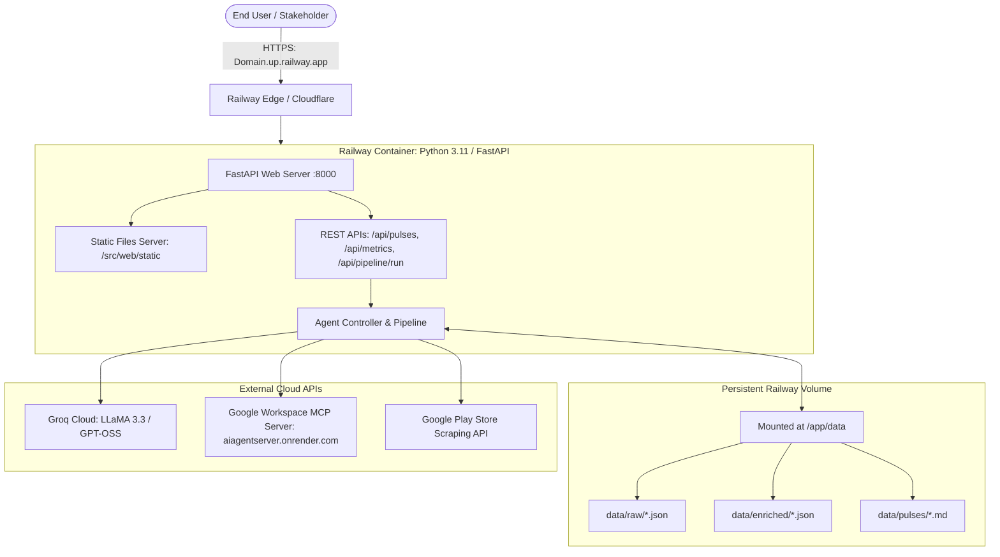

# Groww App Review Pulse Agent — Production Deployment Plan

## 1. Executive Summary & Platform Recommendation

### Can we just use Railway here, or is Vercel also required?
> **Answer: You can 100% just use Railway. Vercel is NOT required.**

While you *can* host the frontend on Vercel if desired, **deploying everything as a unified service on Railway is strongly recommended**. Here is why:

| Factor | Railway Only (Recommended) | Railway (Backend) + Vercel (Frontend) |
| :--- | :--- | :--- |
| **Architecture** | **Unified Full-Stack Container**: FastAPI natively serves the latest static UI (`index.html`, `app.js`, `styles.css`) from `/` and `/static/`. | **Split Architecture**: 2 separate platforms, 2 deployment pipelines, and 2 dashboards to maintain. |
| **CORS & Networking** | **Zero CORS issues**: Browser queries `/api/...` on the exact same origin. | Requires CORS headers, reverse proxy rewrites, or hardcoding backend URLs. |
| **Persistent Storage** | **Supported**: Railway provides Persistent Disk Volumes for `/app/data` (storing raw scraped reviews, enriched clusters, and pulse reports). | **Not Supported on Vercel**: Vercel serverless has a read-only ephemeral filesystem. |
| **Pipeline Execution** | **Unlimited Timeout**: Running the review pipeline (scraping, cleaning, Groq LLM clustering, markdown generation) takes 30–90 seconds. | **Fails on Vercel**: Serverless functions timeout (10–15s limit on free/pro tiers). |
| **Cost & Simplicity** | **1 service, 1 URL**: Free tier or standard usage plan covers both UI and API. | 2 services to manage; higher operational overhead. |

---

## 2. System Architecture



---

## 3. Plan A: Unified Deployment on Railway (Recommended)

### Step 1: Pre-Flight Verification & Git Push
1. Ensure all pre-configured deployment files are tracked in Git:
   - `Dockerfile` (Container build definition)
   - `.dockerignore` (Excludes virtualenvs, cache, and test artifacts)
   - `railway.toml` (Declarative Railway deployment configuration)
   - `Procfile` (Fallback process definition)
   - `requirements.txt` (Pinned production dependencies)
2. Commit and push the codebase to your GitHub repository:
   ```bash
   git add Dockerfile .dockerignore railway.toml Procfile requirements.txt run_web.py src/
   git commit -m "chore: add production Railway deployment configuration"
   git push origin main
   ```

### Step 2: Create a Project in Railway
1. Log into [Railway.app](https://railway.app/).
2. Click **New Project** → **Deploy from GitHub repo**.
3. Select your repository: `aiagent` (or your repository name).
4. Railway will automatically detect the `Dockerfile` and `railway.toml`.

### Step 3: Configure Environment Variables
In your Railway Service dashboard, navigate to the **Variables** tab and add:

| Variable Name | Recommended Value / Description |
| :--- | :--- |
| `PORT` | `8000` *(Railway injects this automatically, but good to declare)* |
| `LLM_PROVIDER` | `groq` |
| `GROQ_API_KEY` | `gsk_...` *(Your Groq API Key)* |
| `GROQ_MODEL` | `openai/gpt-oss-120b` *(or preferred fast Groq model)* |
| `GEMINI_API_KEY` | *(Optional if LLM_PROVIDER is groq)* |
| `APP_ID` | `com.nextbillion.groww` |
| `MCP_SERVER_URL` | `https://aiagentserver.onrender.com` |
| `MCP_TRANSPORT` | `sse` |
| `EMAIL_TO` | `shashikiran9035@gmail.com` |
| `PULSE_EMAIL_RECIPIENTS` | `shashikiran9035@gmail.com` |
| `GROWW_PULSE_DOC_URL` | `https://docs.google.com/document/d/18LgIvY3jE9tJthxHYguw5wVigJhG5BJmd9wvEFbsaDw/edit` |
| `GROWW_PULSE_DOC_ID` | `18LgIvY3jE9tJthxHYguw5wVigJhG5BJmd9wvEFbsaDw` |

### Step 4: Attach a Persistent Disk Volume (Crucial)
Because the pipeline persists scraped reviews (`data/raw/`), enriched outputs (`data/enriched/`), and markdown reports (`data/pulses/`), you should attach a persistent volume so data persists across container redeployments:
1. In the Railway service dashboard, click **Data** / **Volumes** → **Add Volume**.
2. Set Mount Path: `/app/data`.
3. Set Size: `5 GB` (ample for hundreds of weekly reviews).

### Step 5: Expose Public Domain & Healthcheck
1. Navigate to **Settings** → **Networking** → **Public Networking**.
2. Click **Generate Domain** (e.g. `groww-review-pulse.up.railway.app`).
3. Under **Healthcheck**, verify:
   - **Path**: `/api/status`
   - **Timeout**: `100s`
4. Railway will build the container, run the healthcheck against `/api/status`, and route traffic.

---

## 4. Plan B: Split Deployment (Railway Backend + Vercel Frontend)

If you specifically require the static frontend on Vercel's global Edge network:

### Step 1: Deploy Backend to Railway
Follow **Plan A (Steps 1–5)** above to get your Railway backend running at `https://YOUR_BACKEND.up.railway.app`.

### Step 2: Configure Vercel Rewrites (`vercel.json`)
A production-ready `vercel.json` has already been generated in the project root:
```json
{
  "version": 2,
  "rewrites": [
    {
      "source": "/api/(.*)",
      "destination": "https://YOUR_BACKEND.up.railway.app/api/$1"
    },
    {
      "source": "/static/(.*)",
      "destination": "/src/web/static/$1"
    },
    {
      "source": "/(.*)",
      "destination": "/src/web/static/index.html"
    }
  ]
}
```
*Replace `YOUR_BACKEND.up.railway.app` with your actual Railway service domain.*

### Step 3: Deploy to Vercel
1. Log into [Vercel.com](https://vercel.com/) → **Add New** → **Project**.
2. Import the GitHub repository.
3. Configure Project Settings:
   - **Framework Preset**: `Other`
   - **Root Directory**: `./` (leave default)
   - **Output Directory**: `src/web/static`
4. Click **Deploy**. Vercel will serve the static UI and proxy all `/api/*` calls directly to Railway.

---

## 5. Verification & Smoke Testing Checklist

Once deployed on Railway (or Railway + Vercel), run these verification tests:

- [ ] **System Status**: `GET https://YOUR_APP.up.railway.app/api/status` returns `{"status": "online", "mcp": {"status": "connected"}}`.
- [ ] **Weekly Pulses**: `GET https://YOUR_APP.up.railway.app/api/pulses` returns 21 weekly pulses (`2026-W20` to `2026-W40`).
- [ ] **Metrics**: `GET https://YOUR_APP.up.railway.app/api/metrics` returns ratings and weekly breakdowns.
- [ ] **Interactive Dashboard**:
  - Open `https://YOUR_APP.up.railway.app/` in a browser.
  - Verify KPIs (Total reviews, Store rating, Dominant sentiment).
  - Verify week selector switches weeks seamlessly.
  - Test left-hand navigation items (**Dashboard**, **Customer Themes**, **Trend Analytics**, **Delivery Logs**) smoothly scroll to their respective sections.
  - Verify reviews pagination and sentiment filter pills (Critical, Praise, Neutral).
- [ ] **Pipeline Trigger**:
  - In **Delivery Logs**, click **Run Pipeline Now**.
  - Verify the terminal log streams execution steps and updates the status badge.
