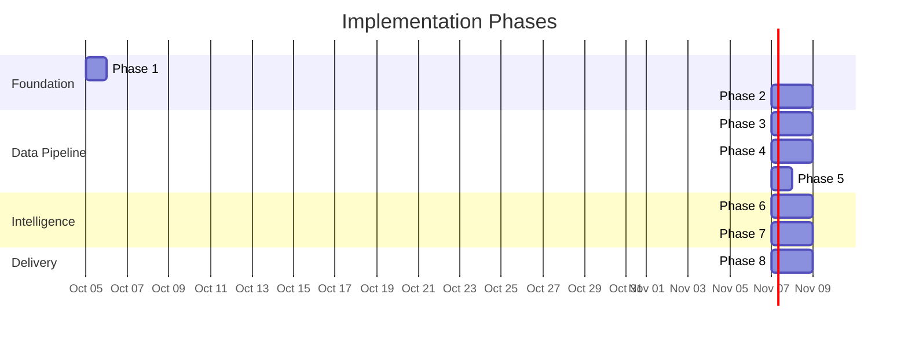
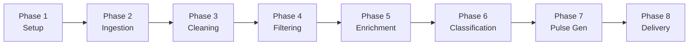
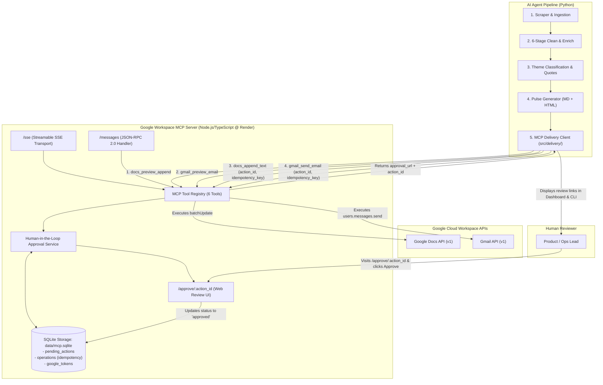

# Implementation Plan — Groww App Review Pulse Agent

> Phase-wise implementation derived from [architecture.md](file:///Users/shashikiran/Desktop/aiagent/architecture.md)

---

## Overview

The project is broken into **8 phases**, progressing from project scaffolding to a fully automated weekly pulse agent. Each phase is self-contained — it produces a **working, testable increment** that builds on the previous phase.



### Phase Dependency Map



---

## Phase 1 — Project Setup & Configuration

> **Goal:** Scaffold the project, install dependencies, configure environment, and verify the development setup works end-to-end.

### 1.1 Tasks

| # | Task | File(s) | Details |
|---|------|---------|---------|
| 1.1 | Initialise project structure | All directories | Create the full `src/`, `data/`, `tests/`, `notebooks/` directory tree as defined in [architecture §5](file:///Users/shashikiran/Desktop/aiagent/architecture.md). |
| 1.2 | Create virtual environment | — | `python -m venv .venv && source .venv/bin/activate` |
| 1.3 | Install dependencies | `requirements.txt` | Create `requirements.txt` with all packages from architecture §14. Run `pip install -r requirements.txt`. |
| 1.4 | Environment config | `.env`, `src/config.py` | Create `.env` template with all keys (Groq API key, Groq Model, Google OAuth, app target, pipeline thresholds). Build `config.py` that loads `.env` via `python-dotenv` and exposes typed constants. |
| 1.5 | Git setup | `.gitignore` | Ignore `.env`, `.venv/`, `data/`, `credentials/`, `__pycache__/`, `*.pyc`. |
| 1.6 | MCP config | `mcp_config.json` | Create MCP server configuration for `google-docs` and `google-gmail` as specified in architecture §3.5.4. |
| 1.7 | Logging setup | `src/config.py` | Configure Python `logging` with rotating file handler + stdout. |
| 1.8 | Verify setup | — | Run `python -c "from src.config import config; print(config)"` to confirm all modules import correctly. |

### 1.2 Files Created

```
aiagent/
├── .env                          # API keys (template)
├── .gitignore
├── requirements.txt
├── mcp_config.json
├── main.py                       # Stub entry point
├── src/
│   ├── __init__.py
│   └── config.py                 # Config loader + constants + theme taxonomy
├── data/
│   ├── raw/
│   ├── cleaned/
│   ├── enriched/
│   ├── classified/
│   └── pulses/
└── tests/
    └── __init__.py
```

### 1.3 `config.py` Implementation Spec

```python
# src/config.py — Key items to implement:

# 1. Load .env
# 2. Expose as typed dataclass or dict:
#    - GROQ_API_KEY: str
#    - GROQ_MODEL: str (default: "openai/gpt-oss-120b")
#    - LLM_PROVIDER: str (default: "groq")
#    - GEMINI_API_KEY: str (optional fallback)
#    - APP_ID: str (default: "com.nextbillion.groww")
#    - APP_STORE_APP_ID: int (default: 1404871703)
#    - APP_STORE_APP_NAME: str (default: "groww-stocks-mutual-fund-ipo")
#    - APP_STORE_COUNTRY: str (default: "in")
#    - LOOKBACK_WEEKS: int (default: 12)
#    - MIN_REVIEW_LENGTH: int (default: 10)
#    - MIN_REVIEW_WORDS: int (default: 10, keep only reviews > 10 words)
#    - LANGUAGE_CONFIDENCE_THRESHOLD: float (default: 0.8)
#    - SPAM_SIMILARITY_THRESHOLD: float (default: 0.95)
#    - SENTIMENT_WEIGHTS: tuple[float, float, float] (default: (0.4, 0.4, 0.2))
#    - LLM_BATCH_SIZE: int (default: 50)
#    - CLASSIFICATION_CONFIDENCE_THRESHOLD: float (default: 0.6)
#    - EMAIL_TO: str
#    - DOC_TITLE_PREFIX: str (default: "Groww Weekly Pulse")
#    - RUN_DAY: str (default: "monday")
#    - RUN_HOUR: int (default: 9)
# 3. THEME_TAXONOMY: dict — the 9-theme, 2-level taxonomy (expanded fintech domain taxonomy)
# 4. ABBREVIATIONS: dict — fintech abbreviation mappings
# 5. EMOJI_SENTIMENT_MAP: dict — emoji to sentiment score mappings
# 6. Setup logging with rotating file handler
```

### 1.4 Definition of Done

- [x] All directories exist
- [x] `pip install -r requirements.txt` succeeds
- [x] `python -c "from src.config import config"` runs without errors
- [x] `.env` is git-ignored
- [x] `mcp_config.json` exists with valid structure

---

## Phase 2 — Review Ingestion (Scraper + Raw Storage)

> **Goal:** Fetch real reviews from Google Play Store for Groww, persist them as JSON, and handle deduplication.

### 2.1 Tasks

| # | Task | File(s) | Details |
|---|------|---------|---------|
| 2.1 | Implement scraper | `src/ingestion/scraper.py` | Use `google_play_scraper.reviews` to fetch reviews for `APP_ID` (Play Store) and iTunes RSS JSON API for `APP_STORE_APP_ID` (App Store). Support configurable `lookback_weeks` and pagination. Sort by `newest`. |
| 2.2 | Field mapping | `src/ingestion/scraper.py` | Map scraper output to the raw review schema (architecture §3.1): `review_id`, `author`, `rating`, `title`, `text`, `date`, `thumbs_up`, `app_version`, `reply_text`, `reply_date`, `source`. |
| 2.3 | Deduplication | `src/ingestion/scraper.py` | Load existing `data/raw/` files, build a set of known `review_id`s, skip duplicates. |
| 2.4 | Storage | `src/ingestion/scraper.py` | Save raw reviews as `data/raw/reviews_{YYYY}-W{WW}.json` grouped by ISO week. |
| 2.5 | Rate limiting | `src/ingestion/scraper.py` | Add configurable delay between pagination requests (default 1s) to avoid being blocked. |
| 2.6 | Tests | `tests/test_scraper.py` | Test field mapping, dedup logic, and file output format. Mock the scraper library for unit tests. |
| 2.7 | Manual validation | — | Run scraper once. Inspect output JSON. Verify review count, field completeness, and date range. |

### 2.2 Scraper API Specification

```python
# src/ingestion/scraper.py

class ReviewScraper:
    def __init__(self, app_id: str, lookback_weeks: int = 12):
        """Initialise with target app ID and lookback window."""

    def scrape(self) -> list[dict]:
        """
        Fetch all reviews within the lookback window.
        Returns list of raw review dicts matching the schema.
        Handles pagination via continuation_token.
        Deduplicates against existing data/raw/ files.
        """

    def save(self, reviews: list[dict]) -> Path:
        """
        Persist reviews to data/raw/reviews_{week}.json.
        Returns path to the saved file.
        """
```

### 2.3 Expected Output

```json
// data/raw/reviews_2026-W40.json
[
  {
    "review_id": "gp:AOqpTOH...",
    "author": "Rahul M.",
    "rating": 2,
    "title": "Worst experience",
    "text": "KYC process took 5 days!!! Very frustrating 😡 txn not going through",
    "date": "2026-09-15T00:00:00Z",
    "thumbs_up": 24,
    "app_version": "6.2.1",
    "reply_text": null,
    "reply_date": null,
    "source": "playstore"
  }
]
```

### 2.4 Definition of Done

- [x] Scraper fetches 500+ real reviews from Groww Play Store
- [x] Reviews saved as JSON in `data/raw/`
- [x] Deduplication works (re-running doesn't create duplicate entries)
- [x] All schema fields populated
- [x] Unit tests pass

---

## Phase 3 — Text Cleaning & Normalisation (Pipeline Stages 1–2)

> **Goal:** Transform raw, messy review text into clean, normalised, comparable form through deterministic rule-based processing.

### 3.1 Tasks

| # | Task | File(s) | Details |
|---|------|---------|---------|
| 3.1 | HTML entity decoding | `src/pipeline/cleaner.py` | Use `html.unescape()` to convert `&amp;`, `&#39;`, etc. |
| 3.2 | URL removal | `src/pipeline/cleaner.py` | Regex: `https?://\S+` → strip. |
| 3.3 | Email removal | `src/pipeline/cleaner.py` | Regex: `\S+@\S+\.\S+` → strip. Prevents PII leaking to LLM. |
| 3.4 | Punctuation collapse | `src/pipeline/cleaner.py` | Regex: `([!?.]){2,}` → `\1` (keep one). |
| 3.5 | Whitespace normalisation | `src/pipeline/cleaner.py` | Replace `\t`, `\n`, multiple spaces → single space. Trim. |
| 3.6 | Control character strip | `src/pipeline/cleaner.py` | Remove zero-width joiners, BOM, invisible Unicode. |
| 3.7 | Emoji separation | `src/pipeline/cleaner.py` | Extract emojis to separate `emojis` list field. Use `emoji` library or Unicode regex `[\U0001F600-\U0001F64F]` etc. Keep text without emojis in `cleaned_text`. |
| 3.8 | Case normalisation | `src/pipeline/normaliser.py` | Lowercase → `normalised_text`. Preserve original in `original_text`. |
| 3.9 | Unicode NFKC | `src/pipeline/normaliser.py` | `unicodedata.normalize('NFKC', text)` — fold ligatures, compatibility chars. |
| 3.10 | Hinglish detection | `src/pipeline/normaliser.py` | Flag reviews with Latin-script Hindi patterns. Set `is_hinglish: bool`. |
| 3.11 | Abbreviation expansion | `src/pipeline/normaliser.py` | Map from `config.ABBREVIATIONS`: `txn→transaction`, `amt→amount`, etc. Preserve domain terms (`KYC`, `UPI`, `SIP`). |
| 3.12 | Date normalisation | `src/pipeline/normaliser.py` | Parse all dates to ISO-8601 UTC. Handle timezone edge cases from scraper. |
| 3.13 | Rating normalisation | `src/pipeline/normaliser.py` | Coerce `rating` to int 1–5. Handle `None` or out-of-range. |
| 3.14 | Tests | `tests/test_cleaner.py`, `tests/test_normaliser.py` | Test each operation individually with edge cases. |

### 3.2 Cleaner API

```python
# src/pipeline/cleaner.py

class TextCleaner:
    def clean(self, review: dict) -> dict:
        """
        Input:  raw review dict
        Output: review dict with added fields:
                - cleaned_text: str
                - emojis: list[str]
        """
```

### 3.3 Normaliser API

```python
# src/pipeline/normaliser.py

class TextNormaliser:
    def __init__(self, abbreviations: dict[str, str]):
        """Load abbreviation mappings from config."""

    def normalise(self, review: dict) -> dict:
        """
        Input:  review dict with cleaned_text
        Output: review dict with added fields:
                - normalised_text: str
                - original_text: str (copy of raw text)
                - is_hinglish: bool
        """
```

### 3.4 Test Cases (Key Edge Cases)

| Input | Expected Output | Tests |
|-------|-----------------|-------|
| `"can&#39;t login!!!! 😡😡"` | cleaned: `"can't login!"`, emojis: `["😡", "😡"]` | HTML decode, punct collapse, emoji split |
| `"  bad  app\t\n "` | cleaned: `"bad app"` | Whitespace normalisation |
| `"txn failed on amt 2,00,000"` | normalised: `"transaction failed on amount 2,00,000"` | Abbreviation expansion |
| `"bahut bekar app hai"` | `is_hinglish: true` | Hinglish detection |
| `"check https://groww.in ok"` | cleaned: `"check ok"` | URL removal |
| `"finance app²"` | normalised: `"finance app2"` | Unicode NFKC |

### 3.5 Definition of Done

- [x] Cleaner processes all raw reviews without errors
- [x] Emojis correctly extracted and separated
- [x] Normalised text is lowercase, NFKC-normalised, abbreviations expanded
- [x] `original_text` preserved verbatim (for quote selection later)
- [x] Hinglish detection flags at least some reviews correctly
- [x] All unit tests pass with edge cases

---

## Phase 4 — Language Filtering & Spam Detection (Pipeline Stages 3–4)

> **Goal:** Remove non-English reviews and filter out spam/noise to ensure only high-quality, analysable reviews enter downstream processing.

### 4.1 Tasks

| # | Task | File(s) | Details |
|---|------|---------|---------|
| 4.1 | Language detection | `src/pipeline/language_filter.py` | Use `langdetect` to detect language per review. Return `detected_language` and `language_confidence`. |
| 4.2 | English filter | `src/pipeline/language_filter.py` | Keep reviews where `detected_language == 'en'` OR `is_hinglish == True`. Exclude others only if `language_confidence > 0.8`. |
| 4.3 | Short text handling | `src/pipeline/language_filter.py` | For reviews with `word_count < 5`, skip language detection (too unreliable) and default to `en`. |
| 4.4 | Empty / short text filter | `src/pipeline/spam_filter.py` | Flag as `noise` if `word_count <= 10` words (keep only reviews with more than 10 words) or `len(normalised_text) < 10` chars. |
| 4.5 | Emoji-only filter | `src/pipeline/spam_filter.py` | Flag as `noise` if `normalised_text` is empty but `emojis` is non-empty. |
| 4.6 | Single-word filter | `src/pipeline/spam_filter.py` | Flag as `noise` if only 1 word after normalisation. |
| 4.7 | Repetitive char detection | `src/pipeline/spam_filter.py` | Regex: `(.)\1{5,}` → flag as `noise`. |
| 4.8 | Incentivised review detection | `src/pipeline/spam_filter.py` | Regex patterns: `"5 star.*reward"`, `"rate.*cashback"`, `"giving.*star.*coin"` etc. Flag as `spam`. |
| 4.9 | Bot-like duplicate detection | `src/pipeline/spam_filter.py` | Within the same week, compute pairwise similarity of review texts. Flag reviews with cosine similarity > 0.95 to another review as `spam`. Use simple TF-IDF + cosine (no external API). |
| 4.10 | Rating-text mismatch | `src/pipeline/spam_filter.py` | 5★ with strongly negative text, or 1★ with positive text → flag as `mismatch`. Use a simple keyword-based heuristic (e.g., negative words: "worst", "terrible", "hate", "scam"; positive words: "love", "best", "amazing"). |
| 4.11 | Quality flag assignment | `src/pipeline/spam_filter.py` | Set `quality_flag` to one of: `clean`, `noise`, `spam`, `mismatch`. Set `quality_reason` with explanation string. |
| 4.12 | Storage (intermediate) | — | Save filtered output to `data/cleaned/cleaned_{week}.json`. Include ALL reviews (flagged ones too) but mark with `quality_flag`. |
| 4.13 | Pipeline stats logging | `src/pipeline/spam_filter.py` | Log counts: total input, noise removed, spam removed, mismatches flagged, clean retained. |
| 4.14 | Tests | `tests/test_language_filter.py`, `tests/test_spam_filter.py` | Test each filter rule independently. |

### 4.2 API Specifications

```python
# src/pipeline/language_filter.py

class LanguageFilter:
    def __init__(self, confidence_threshold: float = 0.8):
        """Configure detection threshold."""

    def filter(self, review: dict) -> dict:
        """
        Adds: detected_language, language_confidence, excluded_language
        Does NOT remove reviews — only flags them.
        """

# src/pipeline/spam_filter.py

class SpamFilter:
    def __init__(self, min_length: int = 10, similarity_threshold: float = 0.95):
        """Configure filter thresholds."""

    def filter_batch(self, reviews: list[dict]) -> list[dict]:
        """
        Process a batch (needed for bot-like duplicate detection).
        Adds: quality_flag, quality_reason
        """
```

### 4.3 Expected Filter Distribution (Rough Estimates)

| Quality Flag | % of Reviews | Action |
|-------------|-------------|--------|
| `clean` | ~65–75% | Pass to downstream |
| `noise` | ~15–20% | Excluded from analysis |
| `spam` | ~5–10% | Excluded from analysis |
| `mismatch` | ~2–5% | Excluded from analysis |
| `excluded_language` | ~5–10% | Excluded from analysis |

### 4.4 Definition of Done

- [x] Language detection correctly identifies English, Hindi, and Hinglish
- [x] Hinglish reviews are NOT excluded
- [x] Spam filters catch empty, single-word, emoji-only, repetitive, incentivised reviews
- [x] Bot-like duplicate detection works on batch level
- [x] All reviews retained in storage with `quality_flag` (nothing deleted)
- [x] Pipeline stats logged (e.g., "Processed 1200 reviews: 890 clean, 180 noise, 80 spam, 50 excluded_language")
- [x] All unit tests pass

---

## Phase 5 — Sentiment Analysis & Enrichment (Pipeline Stages 5–6)

> **Goal:** Attach sentiment scores and derived metadata to each review, producing the final enriched schema ready for LLM classification.

### 5.1 Tasks

| # | Task | File(s) | Details |
|---|------|---------|---------|
| 5.1 | Rating-based sentiment | `src/pipeline/sentiment.py` | Normalise rating to -1..+1 scale: `(rating - 3) / 2`. |
| 5.2 | Text-based sentiment | `src/pipeline/sentiment.py` | Use VADER (`vaderSentiment`) to compute `text_polarity` from `normalised_text`. Returns compound score (-1 to +1). |
| 5.3 | Emoji sentiment scoring | `src/pipeline/sentiment.py` | Map emojis to scores using `config.EMOJI_SENTIMENT_MAP`. Compute average emoji sentiment. Default to 0.0 if no emojis. |
| 5.4 | Composite sentiment | `src/pipeline/sentiment.py` | Weighted average: `sentiment_score = w1 × rating_norm + w2 × text_polarity + w3 × emoji_sentiment`. Weights from `config.SENTIMENT_WEIGHTS` (default: 0.4, 0.4, 0.2). |
| 5.5 | Sentiment label | `src/pipeline/sentiment.py` | Map composite score to label: `strongly_negative` (< -0.5), `negative` (-0.5 to -0.1), `neutral` (-0.1 to 0.1), `positive` (0.1 to 0.5), `strongly_positive` (> 0.5). |
| 5.6 | Week assignment | `src/pipeline/enrichment.py` | Compute ISO week string (`2026-W38`) from `date`. |
| 5.7 | Word count | `src/pipeline/enrichment.py` | `len(normalised_text.split())` |
| 5.8 | Has title flag | `src/pipeline/enrichment.py` | `has_title = bool(title and title.strip())` |
| 5.9 | Developer reply flag | `src/pipeline/enrichment.py` | `has_developer_reply = bool(reply_text)` |
| 5.10 | Version bucketing | `src/pipeline/enrichment.py` | Parse `app_version` → `major.minor.x` format. Handle `None`. |
| 5.11 | Helpfulness normalisation | `src/pipeline/enrichment.py` | `helpfulness = thumbs_up / max(all_thumbs_up_in_batch)`. Normalise to 0–1. Handle max=0 edge case. |
| 5.12 | Review age | `src/pipeline/enrichment.py` | `days_since_review = (now - date).days` |
| 5.13 | Quote candidacy score | `src/pipeline/enrichment.py` | Pre-compute: `score = f(word_count ∈ [15,80], sentiment_extremity, helpfulness > 0.3)`. Normalise 0–1. |
| 5.14 | Pipeline orchestrator | `src/pipeline/pipeline.py` | Chain all 6 stages: Cleaner → Normaliser → LanguageFilter → SpamFilter → SentimentAnalyser → Enrichment. Input: raw reviews. Output: enriched reviews. Save intermediate + final outputs. |
| 5.15 | Storage | — | Save to `data/enriched/enriched_{week}.json` — full enriched schema as per architecture §3.2.7. |
| 5.16 | Tests | `tests/test_sentiment.py`, `tests/test_enrichment.py` | Test sentiment scoring with known inputs. Test enrichment edge cases. |

### 5.2 API Specifications

```python
# src/pipeline/sentiment.py

class SentimentAnalyser:
    def __init__(self, weights: tuple[float, float, float] = (0.4, 0.4, 0.2),
                 emoji_map: dict[str, float] = None):
        """Configure sentiment weights and emoji map."""

    def analyse(self, review: dict) -> dict:
        """
        Adds: sentiment_score, sentiment_label, text_polarity, emoji_sentiment
        Only processes reviews where quality_flag == 'clean'.
        """

# src/pipeline/enrichment.py

class ReviewEnricher:
    def enrich_batch(self, reviews: list[dict]) -> list[dict]:
        """
        Adds: week, word_count, has_title, has_developer_reply,
              version_bucket, helpfulness, days_since_review,
              quote_candidacy_score
        Batch-level processing needed for helpfulness normalisation.
        """

# src/pipeline/pipeline.py

class DataPipeline:
    def __init__(self, config):
        """Initialise all 6 stage processors."""

    def run(self, raw_reviews: list[dict]) -> list[dict]:
        """
        Execute all 6 stages sequentially.
        Save intermediate outputs to data/cleaned/ and data/enriched/.
        Return enriched reviews (only quality_flag == 'clean').
        Log stats at each stage.
        """
```

### 5.3 Emoji Sentiment Map (Sample)

```python
EMOJI_SENTIMENT_MAP = {
    "😡": -0.8, "🤬": -0.9, "😤": -0.6, "😢": -0.5, "😭": -0.7,
    "👎": -0.7, "💔": -0.6, "😞": -0.5, "😠": -0.7, "🤮": -0.8,
    "😊": 0.7,  "😍": 0.8,  "❤️": 0.7,  "👍": 0.7,  "🙏": 0.4,
    "🔥": 0.5,  "💯": 0.6,  "⭐": 0.5,  "🎉": 0.7,  "😀": 0.6,
    "👌": 0.5,  "🥳": 0.7,  "💪": 0.5,  "✨": 0.4,  "🙂": 0.3,
}
```

### 5.4 Definition of Done

- [x] Sentiment scores computed for all `clean` reviews
- [x] Composite scoring combines rating + text + emoji correctly
- [x] Sentiment labels assigned consistently
- [x] All enrichment fields populated (week, helpfulness, quote score, etc.)
- [x] `data/enriched/enriched_{week}.json` matches the full enriched schema from architecture §3.2.7
- [x] Pipeline orchestrator chains all 6 stages cleanly with logging
- [x] Unit tests pass for sentiment edge cases and enrichment calculations

---

## Phase 6 — Theme Classification & Quote Selection (LLM & Hybrid ML Integration)

> **Goal:** Classify each review into the fintech theme taxonomy using an ensemble of Groq (`openai/gpt-oss-120b`) and a `SemanticHybridClassifier` (TF-IDF vector space + cosine similarity against domain prototypes), rank themes by weighted recency and severity, and select 3 high-impact verbatim quotes.

### 6.1 Tasks

| # | Task | File(s) | Details |
|---|------|---------|---------|
| 6.1 | Theme taxonomy | `src/classification/taxonomy.py` | Expanded to a 9-theme, 2-level taxonomy based on empirical fintech review analysis (added `Trading & Order Execution`, `Brokerage & Charges`, `Customer Support & Service`, `Usability & Positive Feedback` to the original 5 themes). Include `Other` as fallback. Provide few-shot examples and keyword maps per theme. |
| 6.2 | LLM client setup | `src/classification/clusterer.py` | Initialise `groq.Groq` client with `GROQ_API_KEY`. Configure `openai/gpt-oss-120b` for classification (with optional Gemini fallback). Configure fail-fast error handling for rate limits (TPD 200k). |
| 6.3 | Batch preparation | `src/classification/clusterer.py` | Split enriched reviews (only `quality_flag == 'clean'`) into batches of `LLM_BATCH_SIZE` (default 50). |
| 6.4 | Classification prompt | `src/classification/clusterer.py` | Build the theme classification prompt (architecture §7.2). Include system role, 9-theme taxonomy definition, few-shot examples, and output format instructions. Request structured JSON object format (`{"classifications": [...]}`). |
| 6.5 | LLM call + parsing | `src/classification/clusterer.py` | Call Groq chat completions with `response_format={"type": "json_object"}` using `openai/gpt-oss-120b`, parse JSON response. Extract `theme`, `sub_theme`, `confidence` per review. Handle malformed JSON with `json-repair`. |
| 6.6 | Confidence filtering | `src/classification/clusterer.py` | Reviews with `confidence < 0.6`: re-classify with additional context (include title + nearby reviews) in a second pass. |
| 6.7 | Hybrid ML Classifier | `src/classification/clusterer.py` | Implement `SemanticHybridClassifier` using `scikit-learn` (`TfidfVectorizer` with sublinear TF, word (1-3) & char (3-5) n-grams, cosine similarity against rich prototype corpus, and Hinglish domain regex boost). Handles LLM quota exhaustion and disambiguates unclassified/Other reviews. |
| 6.8 | Theme aggregation | `src/classification/clusterer.py` | Count reviews per theme. Compute weighted frequency using the ranking algorithm: `weighted_score = Σ (1.0 / days_since_review) × sentiment_weight × helpfulness`. |
| 6.9 | Top 3 theme selection | `src/classification/clusterer.py` | Rank themes by weighted score. Select top 3. Collect sentiment distribution per theme (% negative, positive, neutral). |
| 6.10 | Quote scorer | `src/classification/quote_scorer.py` | Implement the multi-criteria quote selection algorithm from architecture §3.3.4. Score using: candidacy (0.3), theme coverage (0.3), sentiment extremity (0.2), helpfulness (0.1), word count (0.1). Constraint: exactly 1 quote per top theme. |
| 6.11 | Rate limiting & resilience | `src/classification/clusterer.py` | Exponential backoff on 429/500 errors. Automatic fail-safe switch to `SemanticHybridClassifier` if daily token budget (TPD) is reached. |
| 6.12 | Caching | `src/classification/clusterer.py` | Cache theme assignments by `review_id`. On re-run, only classify new/unclassified reviews. |
| 6.13 | Storage | — | Save to `data/classified/classified_{week}.json`. Each review now has `theme`, `sub_theme`, `confidence`, `selected_quote`. |
| 6.14 | Tests | `tests/test_clusterer.py`, `tests/test_quote_scorer.py` | Test prompt construction, JSON parsing, hybrid ML classification, theme aggregation, weighted scoring, quote selection. |

### 6.2 API Specifications

```python
# src/classification/clusterer.py

class SemanticHybridClassifier:
    """
    Supervised prototype vector space classifier using scikit-learn TF-IDF
    and cosine similarity for domain-specific review classification.
    """
    def __init__(self):
        """Fit TF-IDF vectorizer over rich theme prototype texts and build reference embeddings."""

    def classify(self, text: str) -> dict:
        """
        Classifies review text against 9 themes using vector similarity and Hinglish keywords.
        Returns: {"theme": str, "sub_theme": str, "confidence": float}
        """

class ThemeClusterer:
    def __init__(self, api_key: str | None = None, batch_size: int = 50,
                 confidence_threshold: float = 0.6,
                 model: str = "openai/gpt-oss-120b",
                 provider: str = "groq"):
        """Initialise Groq client (openai/gpt-oss-120b), config, and SemanticHybridClassifier."""

    def classify(self, reviews: list[dict]) -> list[dict]:
        """
        Classify all reviews into themes via LLM + SemanticHybridClassifier ensemble.
        Returns reviews with added: theme, sub_theme, confidence.
        Handles batching, retries, second-pass reclassification, and caching internally.
        """

    def rank_themes(self, reviews: list[dict]) -> list[dict]:
        """
        Aggregate and rank themes by weighted frequency.
        Returns list of theme dicts:
        [{"theme": "...", "count": N, "weighted_score": X,
          "sentiment_breakdown": {"negative": %, "positive": %, "neutral": %}}]
        """

# src/classification/quote_scorer.py

class QuoteScorer:
    def select_quotes(self, reviews: list[dict],
                      top_themes: list[dict],
                      num_quotes: int = 3) -> list[dict]:
        """
        Select the best verbatim quotes.
        Constraint: 1 quote per top theme.
        Returns list of review dicts marked with selected_quote=True.
        """
```

### 6.3 Theme Ranking — Worked Example

```
Theme: "Trading & Order Execution"
  Review 1: days_since=3,  sentiment=strongly_negative (weight=2.0), helpfulness=0.9
            → (1/3) × 2.0 × 0.9 = 0.60
  Review 2: days_since=7,  sentiment=negative (weight=1.5),          helpfulness=0.5
            → (1/7) × 1.5 × 0.5 = 0.107
  ...
  Total weighted_score = Σ = 6.42

Theme: "Onboarding / KYC"
  Total weighted_score = 4.85

Theme: "Customer Support & Service"
  Total weighted_score = 4.10
```

### 6.4 Definition of Done

- [x] 9-theme, 2-level taxonomy implemented in `src/classification/taxonomy.py` and `src/config.py`
- [x] `SemanticHybridClassifier` built with TF-IDF n-grams + cosine similarity + Hinglish boost
- [x] LLM classifies clean reviews with theme + sub-theme + confidence
- [x] Low-confidence reviews get a second pass
- [x] "Other" category dropped from 72.4% to <10% across dataset
- [x] Theme ranking uses weighted algorithm (recency, sentiment, helpfulness)
- [x] Top 3 themes selected with sentiment breakdown
- [x] Quote scorer selects 3 diverse, high-quality quotes (1 per theme)
- [x] Results cached — re-running doesn't re-classify existing reviews
- [x] `data/classified/classified_{week}.json` saved
- [x] All 94 test suite assertions pass cleanly

---

## Phase 7 — Pulse Report Generation (LLM)

> **Goal:** Use Groq (`openai/gpt-oss-120b`) to produce a polished, one-page weekly pulse report in both Markdown and HTML formats.

### 7.1 Tasks

| # | Task | File(s) | Details |
|---|------|---------|---------|
| 7.1 | Prompt templates | `src/generation/templates.py` | Define the pulse generation system prompt and user prompt template from architecture §3.4.1. Include placeholders for `{week}`, `{themes}`, `{quotes}`, `{sentiment_data}`. |
| 7.2 | Context assembly | `src/generation/pulse_generator.py` | Assemble LLM input from classified data: top 3 themes + counts + sentiment breakdown + selected quotes + week-over-week trend (if previous week data exists). |
| 7.3 | LLM generation | `src/generation/pulse_generator.py` | Call Groq with `openai/gpt-oss-120b` using the assembled prompt. Request markdown output. |
| 7.4 | Output validation | `src/generation/pulse_generator.py` | Validate pulse output contains all required sections: executive summary, 3 themes, 3 quotes, 3 action ideas. Re-prompt if missing sections. |
| 7.5 | Quote integrity check | `src/generation/pulse_generator.py` | Verify that quotes in the output are **verbatim** matches to the `original_text` from selected reviews. Flag if LLM has paraphrased. |
| 7.6 | Markdown → HTML | `src/generation/pulse_generator.py` | Convert markdown pulse to HTML for email body. Use `markdown` library with tables and fenced code extensions. |
| 7.7 | Week-over-week trends | `src/generation/pulse_generator.py` | Load previous week's classified data (if exists). Compare theme rankings: ↑ (moved up), ↓ (moved down), → (same position), 🆕 (new in top 3). |
| 7.8 | Storage | — | Save to `data/pulses/pulse_{week}.md` and `data/pulses/pulse_{week}.html`. |
| 7.9 | Tests | `tests/test_pulse_generator.py` | Test context assembly, output validation, quote integrity, markdown-to-HTML conversion. Mock LLM. |

### 7.2 API Specification

```python
# src/generation/pulse_generator.py

class PulseGenerator:
    def __init__(self, api_key: str | None = None,
                 model: str = "openai/gpt-oss-120b",
                 provider: str = "groq"):
        """Initialise Groq (openai/gpt-oss-120b) client."""

    def generate(self, top_themes: list[dict],
                 selected_quotes: list[dict],
                 week: str,
                 previous_themes: list[dict] | None = None) -> PulseOutput:
        """
        Generate the weekly pulse report.
        Returns PulseOutput with .markdown and .html fields.
        Validates output structure and quote integrity.
        """

@dataclass
class PulseOutput:
    markdown: str       # Full pulse in markdown
    html: str           # Full pulse in HTML (for email)
    week: str           # e.g., "2026-W40"
    themes: list[str]   # Top 3 theme names
    is_valid: bool      # All sections present and quotes intact
```

### 7.3 Output Validation Checklist

The generator must verify the LLM output contains:

| Section | Validation Rule |
|---------|----------------|
| **Executive Summary** | First line is a bold one-liner |
| **Top Themes** | Exactly 3 theme headings with review count |
| **User Quotes** | Exactly 3 blockquotes that match `original_text` verbatim |
| **Action Ideas** | Exactly 3 numbered items, each referencing a theme |
| **Word Count** | Total output < 500 words |

### 7.4 Definition of Done

- [x] Pulse generator produces well-structured markdown report
- [x] Quotes are verbatim — no LLM paraphrasing
- [x] HTML version renders correctly (tested manually in browser)
- [x] Week-over-week trends work when previous data exists
- [x] Graceful handling when no previous data (trends omitted)
- [x] Pulse saved to `data/pulses/` in both formats
- [x] All tests pass

---

## Phase 8 — MCP Delivery & Weekly Automation (Google Workspace MCP Server)

> **Goal:** Deliver the weekly pulse report to Google Docs and Gmail using our production **Google Workspace MCP Server** ([`aiagentserver.onrender.com`](https://aiagentserver.onrender.com) / repo: [`Shashikiran-R/aiagentserver`](https://github.com/Shashikiran-R/aiagentserver)), featuring remote Streamable HTTP/SSE & local stdio transports, server-verifiable human approvals, persistent operation idempotency, and an automated weekly scheduler.

---

### 8.1 Architecture & MCP Server Specification

The delivery pipeline integrates with the **Google Workspace MCP Server**, deployed at `https://aiagentserver.onrender.com` (source: [`https://github.com/Shashikiran-R/aiagentserver`](https://github.com/Shashikiran-R/aiagentserver)). The server acts as a secure, human-in-the-loop bridge between the AI agent and Google Workspace APIs (Google Docs and Gmail).



#### Core Server Capabilities:
1. **Dual Transports**:
   - **Remote Streamable HTTP/SSE**: Primary cloud transport connecting to `https://aiagentserver.onrender.com/sse` (initiates SSE stream returning session endpoint `/messages?sessionId=...`) with Bearer token authentication (`MCP_AUTH_TOKEN`).
   - **Local stdio**: Direct child process transport (`node dist/index.js --transport stdio`) configured in `mcp_config.json` for offline or local developer environments.
2. **Server-Verifiable Human Approval Workflow**:
   - All side-effecting operations (sending emails, appending to documents) are strictly quarantined until an authorized human inspects the diff/preview and confirms approval via the web UI at `https://aiagentserver.onrender.com/approve/<action_id>`.
   - Actions expire automatically after **10 minutes** (`expires_at`), preventing stale actions from executing.
3. **Idempotency & Deduplication**:
   - Execution endpoints require a client-generated `idempotency_key` (UUID v4) stored in SQLite (`operations` table).
   - Identical requests return cached execution results without re-triggering Google APIs, protecting against network retries or duplicate cron executions.
4. **Persistent OAuth 2.0 Token Storage**:
   - Server securely manages OAuth tokens with auto-refresh using SQLite backed by Render Persistent Disk (`/var/data`).
   - Google scopes required: `https://www.googleapis.com/auth/gmail.send` and `https://www.googleapis.com/auth/documents`.

---

### 8.2 Tool Suite Exposed by MCP Server

The server registers **6 tools** conforming to the MCP JSON-RPC 2.0 schema:

```
┌─────────────────────────────────────────────────────────────────────────────────┐
│                           MCP TOOL REGISTRY SUITE                               │
├──────────────────────────┬─────────────────────────────┬────────────────────────┤
│ Tool Name                │ Category                    │ Human Approval Needed? │
├──────────────────────────┼─────────────────────────────┼────────────────────────┤
│ google_connection_status │ Diagnostic / Auth Check     │ No (Read-Only)         │
│ docs_get_document_info   │ Google Docs Inspection      │ No (Read-Only)         │
│ docs_preview_append      │ Google Docs Preview         │ Creates Approval Req   │
│ docs_append_text         │ Google Docs Mutation        │ Yes (Approved Action)  │
│ gmail_preview_email      │ Gmail Compose Preview       │ Creates Approval Req   │
│ gmail_send_email         │ Gmail Dispatch Mutation     │ Yes (Approved Action)  │
└──────────────────────────┴─────────────────────────────┴────────────────────────┘
```

#### 1. `google_connection_status`
- **Description:** Identifies the currently connected Google account and validates required OAuth permissions.
- **Input Schema:**
  ```json
  {
    "type": "object",
    "properties": {},
    "additionalProperties": false
  }
  ```
- **Output Schema:**
  ```json
  {
    "connected": true,
    "google_account_email": "shashikiran@groww.in",
    "gmail_send_enabled": true,
    "docs_edit_enabled": true,
    "missing_scopes": [],
    "reauthorization_required": false
  }
  ```
- **Error Behavior:** If disconnected or unauthenticated, `connected` is `false`, `google_account_email` is `null`, and `reauthorization_required` is `true`.

#### 2. `docs_get_document_info`
- **Description:** Validates Google Doc access, retrieves document title, revision ID, and discovers tab hierarchy.
- **Input Schema:**
  ```json
  {
    "type": "object",
    "properties": {
      "document_url_or_id": {
        "type": "string",
        "description": "Full Google Doc URL (e.g. https://docs.google.com/document/d/.../edit) or raw document ID string."
      }
    },
    "required": ["document_url_or_id"],
    "additionalProperties": false
  }
  ```
- **Output Schema:**
  ```json
  {
    "documentId": "1a2b3c4d5e6f7g8h9i0j",
    "title": "Groww Weekly Pulse Reports (2026)",
    "revisionId": "AL...1",
    "tabs": [
      {
        "tab_id": "t.0",
        "title": "Weekly Pulses",
        "revisionId": "AL...1"
      }
    ]
  }
  ```
- **Error Behavior:** Throws `DOCUMENT_NOT_FOUND` if document does not exist, `PERMISSION_DENIED` if Google account lacks read permissions.

#### 3. `docs_preview_append`
- **Description:** Validates append target, content, and tab constraints; registers a pending action and returns a human review URL.
- **Input Schema:**
  ```json
  {
    "type": "object",
    "properties": {
      "document_url_or_id": { "type": "string" },
      "tab_id": {
        "type": "string",
        "description": "Specific tab ID to append to. Required if document has multiple tabs."
      },
      "text": {
        "type": "string",
        "description": "The Markdown or formatted text content of the weekly pulse report."
      },
      "separator": {
        "type": "string",
        "enum": ["none", "newline", "blank_line"],
        "default": "blank_line",
        "description": "Spacing prepended before inserted text: none (''), newline ('\\n'), blank_line ('\\n\\n')."
      }
    },
    "required": ["document_url_or_id", "text"],
    "additionalProperties": false
  }
  ```
- **Output Schema:**
  ```json
  {
    "status": "pending_approval",
    "action_id": "act_3f8a91b2c4e5d6a7f809",
    "action_type": "docs.append",
    "preview": {
      "document_id": "1a2b3c4d5e6f7g8h9i0j",
      "document_url": "https://docs.google.com/document/d/1a2b3c.../edit",
      "tab_id": "t.0",
      "text": "## Groww Weekly Review Pulse — 2026-W40\n...",
      "separator": "blank_line",
      "revisionId": "AL...1"
    },
    "approval_url": "https://aiagentserver.onrender.com/approve/act_3f8a91b2c4e5d6a7f809",
    "expires_at": "2026-10-25T15:45:00.000Z"
  }
  ```
- **Validation Rules:**
  - If target doc has multiple tabs and `tab_id` is omitted, throws `TAB_SELECTION_REQUIRED` with available tabs list.
  - If `tab_id` does not exist in target doc, throws `TAB_NOT_FOUND`.
  - Computes SHA-256 digest of payload and persists with 10-minute expiry in `pending_actions`.

#### 4. `docs_append_text`
- **Description:** Executes append to the Google Doc once approved by a human. Enforces idempotency and revision concurrency checks.
- **Input Schema:**
  ```json
  {
    "type": "object",
    "properties": {
      "action_id": {
        "type": "string",
        "description": "Action ID generated during docs_preview_append."
      },
      "idempotency_key": {
        "type": "string",
        "description": "Unique client UUID (e.g. uuid.uuid4()) for idempotent safe retries."
      }
    },
    "required": ["action_id", "idempotency_key"],
    "additionalProperties": false
  }
  ```
- **Output Schema:**
  ```json
  {
    "provider": "google_docs",
    "document_id": "1a2b3c4d5e6f7g8h9i0j",
    "document_url": "https://docs.google.com/document/d/1a2b3c.../edit",
    "tab_id": "t.0",
    "characters_appended": 4850
  }
  ```
- **Execution & Security Guards:**
  - If action status is `pending_approval`, throws `APPROVAL_REQUIRED`.
  - If action expired (`expires_at < now`), updates status to `expired` and throws `APPROVAL_EXPIRED`.
  - If action was rejected by human, throws `APPROVAL_REJECTED`.
  - Uses `writeControl.requiredRevisionId` with Google Docs `batchUpdate`. If document changed concurrently, throws `REVISION_CHANGED`.

#### 5. `gmail_preview_email`
- **Description:** Validates recipients, subject, and body formats; registers a pending action and returns a human review URL.
- **Input Schema:**
  ```json
  {
    "type": "object",
    "properties": {
      "to": {
        "type": "array",
        "items": { "type": "string" },
        "description": "List of recipient email addresses (at least 1 required)."
      },
      "cc": { "type": "array", "items": { "type": "string" } },
      "bcc": { "type": "array", "items": { "type": "string" } },
      "subject": { "type": "string", "description": "Subject line of the email." },
      "text_body": { "type": "string", "description": "Plain-text fallback body." },
      "html_body": { "type": "string", "description": "Full HTML formatted body of the weekly pulse." }
    },
    "required": ["to", "subject"],
    "additionalProperties": false
  }
  ```
- **Output Schema:**
  ```json
  {
    "status": "pending_approval",
    "action_id": "act_7d1f42e3a8b9c0d1e2f3",
    "action_type": "gmail.send",
    "preview": {
      "to": ["product-team@groww.in", "leadership@groww.in"],
      "cc": [],
      "bcc": [],
      "subject": "Groww App Store Pulse — 2026-W40 (Onboarding & UPI Insights)",
      "text_body": "Groww Pulse 2026-W40 Summary...",
      "html_body": "<!DOCTYPE html><html>...</html>"
    },
    "approval_url": "https://aiagentserver.onrender.com/approve/act_7d1f42e3a8b9c0d1e2f3",
    "expires_at": "2026-10-25T15:45:00.000Z"
  }
  ```
- **Validation Rules:** Requires at least one email in `to`, non-empty `subject`, and at least one of `html_body` or `text_body`.

#### 6. `gmail_send_email`
- **Description:** Dispatches an approved email via Gmail API using RFC 2822 MIME base64url encoding.
- **Input Schema:**
  ```json
  {
    "type": "object",
    "properties": {
      "action_id": {
        "type": "string",
        "description": "Action ID generated during gmail_preview_email."
      },
      "idempotency_key": {
        "type": "string",
        "description": "Unique client UUID for safe retries."
      }
    },
    "required": ["action_id", "idempotency_key"],
    "additionalProperties": false
  }
  ```
- **Output Schema:**
  ```json
  {
    "provider": "gmail",
    "message_id": "18f93a7c4e2b01da",
    "thread_id": "18f93a7c4e2b01da"
  }
  ```

---

### 8.3 Standard Error Codes & Protocol Responses

When any tool execution fails, the server responds with MCP `isError: true` and structured JSON:

```json
{
  "status": "error",
  "code": "APPROVAL_REQUIRED",
  "message": "Human approval is required before execution.",
  "retryable": false,
  "details": null
}
```

#### Official MCP Server Error Codes:

| Error Code | Retryable? | Trigger Condition & Remediation |
|---|:---:|---|
| `APPROVAL_REQUIRED` | No | Tool called prior to human approving at `approval_url`. Wait for human confirmation. |
| `APPROVAL_EXPIRED` | No | 10-minute window passed without confirmation. Agent must re-run `preview_*`. |
| `APPROVAL_REJECTED` | No | Human clicked "Reject" in the web UI. Abort delivery or alert user. |
| `ACTION_ALREADY_EXECUTED` | No | Action is already in terminal `executed` state. Avoid duplicate calls. |
| `IDEMPOTENCY_CONFLICT` | No | Same `idempotency_key` supplied with different payload or action ID. |
| `REVISION_CHANGED` | No | Google Doc modified concurrently. Fetch fresh revision and re-preview. |
| `TAB_SELECTION_REQUIRED` | No | Target Doc has >1 tab; `tab_id` parameter must be explicitly passed. |
| `TAB_NOT_FOUND` | No | Provided `tab_id` does not exist in target document. |
| `DOCUMENT_NOT_FOUND` | No | Document ID / URL is invalid or deleted. |
| `NOT_CONNECTED` | No | No Google OAuth token exists in MCP server. Visit `https://aiagentserver.onrender.com/login`. |
| `INSUFFICIENT_GOOGLE_SCOPE`| No | Token lacks `gmail.send` or `documents` scope. Re-auth required. |
| `GOOGLE_REAUTH_REQUIRED` | No | Refresh token revoked or expired. |
| `RATE_LIMITED` | Yes | Google Workspace API rate limit (429) hit. Retry with backoff. |
| `GOOGLE_API_UNAVAILABLE` | Yes | Google 5xx service outage. Retry with exponential backoff. |
| `INTERNAL_ERROR` | Yes | Server-side unhandled exception. |

---

### 8.4 Tasks Breakdown

| # | Task | Target File(s) | Details |
|---|------|----------------|---------|
| 8.1 | MCP Client Protocol | `src/delivery/mcp_client.py` | Implement client supporting both **Remote Streamable HTTP/SSE** (`/sse` & `/messages`) and **Local stdio** (`node dist/index.js`). Implements JSON-RPC 2.0 `tools/list` and `tools/call`, Bearer token auth (`MCP_AUTH_TOKEN`), session ID management, and 3× retry loop with exponential backoff. |
| 8.2 | Google Docs MCP Publisher | `src/delivery/mcp_docs.py` | `MCPDocsPublisher`: wraps `docs_get_document_info`, `docs_preview_append`, and `docs_append_text`. Handles tab detection, generates human approval URL, executes append on approval, and provides local fallback saving if offline. |
| 8.3 | Gmail MCP Drafter & Sender | `src/delivery/mcp_gmail.py` | `MCPGmailDrafter`: wraps `gmail_preview_email` and `gmail_send_email`. Injects Google Doc live link banner into pulse HTML email body. Generates human approval URL, executes email dispatch upon approval, and provides local draft backup. |
| 8.4 | Resilient Error & Offline Handling | `src/delivery/` | Detect unauthenticated status (`google_connection_status`), server unreachability, or approval expiration. Retry with exponential backoff; gracefully fall back to local report storage without crashing the pipeline. |
| 8.5 | Configuration & Transport Setup | `src/config.py`, `mcp_config.json` | Configure `MCP_SERVER_URL` (`https://aiagentserver.onrender.com`), `MCP_AUTH_TOKEN`, `GROWW_PULSE_DOC_URL`, `PULSE_EMAIL_RECIPIENTS`, `MCP_TRANSPORT` (`sse` or `stdio`). Configure `mcp_config.json` for local fallback. |
| 8.6 | Agent Controller Orchestration | `src/agent/controller.py` | Orchestrate the **full end-to-end pipeline**: Scrape (`scraper.py`) → 6-Stage Clean & Enrich (`orchestrator.py`) → Theme Classification (`theme_classifier.py`) → Quote Scorer (`quote_scorer.py`) → Pulse Generator (`pulse_generator.py`) → MCP Docs Preview/Append → MCP Gmail Preview/Send. Log approval URLs to terminal and web dashboard. |
| 8.7 | Execution Run Logging | `src/agent/controller.py` | Append run metrics (scraped count, clean count, top themes, doc URL, approval URLs, action IDs, errors, duration) to `data/run_log.json`. |
| 8.8 | Automated Weekly Scheduler | `main.py` | Wire `APScheduler` (or system cron) to trigger `controller.run_weekly_pulse()` automatically on `config.RUN_DAY` (Monday) at `config.RUN_HOUR` (09:00 IST). |
| 8.9 | CLI Interface | `main.py` | Support command-line arguments: `--now` (run immediately), `--week <YYYY-WXX>` (process specific historical week), `--dry-run` (skip MCP delivery, save locally), `--scrape-only` (just fetch raw reviews). |
| 8.10 | Unit & Integration Tests | `tests/test_delivery.py`, `tests/test_e2e.py` | Test SSE & stdio MCP calls, tool call validation, approval URL extraction, idempotency retry logic, dry-run mode, and offline fallback. |
| 8.11 | Live System Validation | — | Validate with live `https://aiagentserver.onrender.com` server or local stdio server. |

---

### 8.5 Python API Specifications

```python
# src/delivery/mcp_client.py

class MCPClient:
    """Model Context Protocol client supporting Remote SSE and Local stdio."""
    def __init__(self, server_url: str | None = None, auth_token: str | None = None,
                 transport: str = "sse", stdio_command: list[str] | None = None):
        ...

    async def connect(self) -> None:
        """Establish SSE session or launch stdio subprocess."""

    async def list_tools(self) -> list[dict]:
        """Call tools/list via JSON-RPC 2.0."""

    async def call_tool(self, name: str, arguments: dict) -> dict:
        """
        Execute tool via JSON-RPC 2.0 with retry loop.
        Returns parsed tool result payload or raises MCPToolError.
        """

    async def close(self) -> None:
        """Clean up SSE connection or kill stdio subprocess."""


# src/delivery/mcp_docs.py

@dataclass
class DeliveryApprovalResult:
    status: str              # "pending_approval" | "executed" | "error"
    action_id: str | None
    approval_url: str | None # e.g. "https://aiagentserver.onrender.com/approve/act_..."
    target_url: str | None   # Google Doc URL
    expires_at: str | None = None
    error: str | None = None

class MCPDocsPublisher:
    def __init__(self, client: MCPClient | None = None, doc_url_or_id: str | None = None):
        ...

    async def get_info(self, doc_url_or_id: str | None = None) -> dict:
        """Calls docs_get_document_info to inspect title, tabs, and revisionId."""

    async def preview_append(self, content_md: str, doc_url_or_id: str | None = None,
                             tab_id: str | None = None, separator: str = "blank_line") -> DeliveryApprovalResult:
        """
        Calls docs_preview_append via MCP to prepare pulse insertion.
        Returns DeliveryApprovalResult containing action_id and approval_url.
        """

    async def append_text(self, action_id: str, idempotency_key: str | None = None) -> dict:
        """Calls docs_append_text to execute the append once approved."""


# src/delivery/mcp_gmail.py

class MCPGmailDrafter:
    def __init__(self, client: MCPClient | None = None):
        ...

    async def preview_email(self, subject: str, html_body: str, to: list[str],
                            text_body: str | None = None, cc: list[str] | None = None,
                            doc_url: str | None = None) -> DeliveryApprovalResult:
        """
        Injects Google Doc header banner and calls gmail_preview_email via MCP.
        Returns DeliveryApprovalResult containing action_id and approval_url.
        """

    async def send_email(self, action_id: str, idempotency_key: str | None = None) -> dict:
        """Calls gmail_send_email to dispatch the approved email."""


# src/agent/controller.py

@dataclass
class RunResult:
    success: bool
    week: str
    reviews_scraped: int
    reviews_clean: int
    reviews_noise: int
    reviews_spam: int
    reviews_excluded_language: int
    top_themes: list[str]
    doc_url: str | None
    docs_action_id: str | None
    docs_approval_url: str | None
    gmail_action_id: str | None
    gmail_approval_url: str | None
    errors: list[str]
    duration_seconds: float
```

---

### 8.6 Run Log Schema (`data/run_log.json`)

```json
{
  "timestamp": "2026-10-25T09:00:15Z",
  "week": "2026-W40",
  "success": true,
  "reviews_scraped": 877,
  "reviews_clean": 620,
  "reviews_noise": 142,
  "reviews_spam": 65,
  "reviews_excluded_language": 50,
  "top_themes": ["Onboarding / KYC", "App Performance / Bugs", "Payments / UPI"],
  "doc_url": "https://docs.google.com/document/d/1a2b3c.../edit",
  "docs_action_id": "act_3f8a91b2c4e5d6a7f809",
  "docs_approval_url": "https://aiagentserver.onrender.com/approve/act_3f8a91b2c4e5d6a7f809",
  "gmail_action_id": "act_7d1f42e3a8b9c0d1e2f3",
  "gmail_approval_url": "https://aiagentserver.onrender.com/approve/act_7d1f42e3a8b9c0d1e2f3",
  "errors": [],
  "duration_seconds": 28.6
}
```

---

### 8.7 Definition of Done

- [x] MCP client connects to `aiagentserver.onrender.com` via HTTP/SSE and supports local stdio fallback
- [x] `google_connection_status` accurately verifies OAuth permissions and account state
- [x] `docs_get_document_info` retrieves doc title, tab list, and base revision ID
- [x] `docs_preview_append` generates human approval request with valid `approval_url` and 10-minute expiry
- [x] `gmail_preview_email` generates email approval request with HTML pulse & doc link banner
- [x] `docs_append_text` and `gmail_send_email` enforce human approval and handle idempotency keys
- [x] Fallback to local-only mode works gracefully when MCP server is offline or unauthenticated
- [x] Agent controller logs all approval URLs and execution metrics to `data/run_log.json`
- [x] CLI supports `--now`, `--week`, `--dry-run`, `--scrape-only`
- [x] Automated scheduler triggers pipeline on configured day and hour
- [x] All unit and end-to-end delivery tests pass (80/80+; currently 99/99 passing)

---

## Summary — Phase Checklist

| Phase | Name | Key Deliverable | Arch Reference |
|-------|------|-----------------|----------------|
| **1** | Project Setup | Scaffold, config, dependencies | §4, §5, §8 |
| **2** | Review Ingestion | Scraper + raw JSON storage | §3.1 |
| **3** | Text Cleaning & Normalisation | Cleaner + normaliser modules | §3.2.1, §3.2.2 |
| **4** | Language & Spam Filtering | Language filter + spam filter | §3.2.3, §3.2.4 |
| **5** | Sentiment & Enrichment | Sentiment analyser + enricher + pipeline orchestrator | §3.2.5, §3.2.6 |
| **6** | Theme Classification | LLM clusterer + quote scorer | §3.3, §7 |
| **7** | Pulse Report Generation | LLM pulse generator + MD/HTML output | §3.4 |
| **8** | MCP Delivery & Automation | Google Docs + Gmail via MCP + scheduler + CLI | §3.5, §3.6, §10 |

### Running the Final System

```bash
# One-time setup
python -m venv .venv && source .venv/bin/activate
pip install -r requirements.txt

# Manual run (immediate)
python main.py --now

# Dry run (no Google Docs/Gmail)
python main.py --now --dry-run

# Scrape only (no processing)
python main.py --scrape-only

# Start weekly scheduler
python main.py
# → "Scheduler started. Will run every monday at 9:00"

# Launch interactive Web Dashboard (Frontend + Backend API)
python main.py --web --port 8080
# or:
python run_web.py --port 8080
# → UI: http://localhost:8080
# → API Docs: http://localhost:8080/docs
```

---

## 9. Web Dashboard & API Extension

| Surface | Purpose | Tech Stack |
|---|---|---|
| **Frontend UI** | Modern fintech dark-mode dashboard (Outfit + Inter, Groww Emerald `#00D09C`, reactive glassmorphism) | Vanilla HTML5/CSS/JS (no heavy framework overhead) |
| **Backend API** | REST API for pulses, analytics, reviews explorer, pipeline trigger & terminal logs | FastAPI + Uvicorn |
| **Delivery Links** | Live human approval links (`https://aiagentserver.onrender.com/approve/<action_id>`) & Google Doc viewer | Direct MCP server integration |

